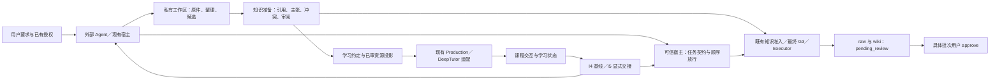

---

> 公开设计摘编：保留通用契约与方案；历史验收、用户反馈、运行记录及本地素材不随仓库发布。设计条目不代表部署或验收完成。

## 2. 目标与交付边界

系统服务于两个可以独立发生的需求：把资料整理为可追溯知识；把指定内容组织成用户可交互学习的课程。外部 Agent 承担资料获取、整理、核验和较复杂任务；内部教学 Agent 消费已准备资源，负责讲解、练习和学习状态操作。内部 Agent 的模型能力不预设较弱，工程职责保持收敛。

修订要解决：新 Agent 能找到入口并继续任务；用户的特殊顺序要求可执行；知识或目录演进不造成不必要返工；附件和历史资料增长不会过早卡死；成本与验证口径可解释。

部署目标仍为本机单用户、共享目录、固定上游适配器。协作门禁不等于阻止同用户进程直接写文件。多用户、跨机器同步、自动掌握评估、来源撤回全图传播和常驻通用 Agent 均不作为本轮实施前提。网页／MCP 可以随后消费同一应用接口，不新增另一套业务逻辑。

## 3. 目标架构与数据所有权

该图是目标职责图，T 中的跨操作业务任务契约与学习放行尚未实现；不能把图读成当前全链已接通。

T 只在受控知识提交／C2 等需要时承载约束。纯学习路线可以只用学习适配与自身 EvidenceStore，不需要 wiki 根、wiki Runtime 或新增业务任务登记；跨链关联是可选定位，不是所有课程的启动前提。

| 边界 | 唯一负责的内容 | 不承担的内容 |
| --- | --- | --- |
| 外部 Agent／宿主采集能力 | 搜索、网页抓取、资料筛选、原件留存、候选准备 | 不从工具成功或模型 JSON 自动取得正式写权限 |
| 私有工作区 | 尚未入库资料、完整原件、候选资源、失败记录 | 不作为 wiki 正式事实或学习状态库 |
| 知识准备模块 | 原文定位、Claim／Evidence、旧知识比较、独立来源与冲突观察 | 不创建课程、推断掌握程度或签发用户授权 |
| 可信 Host／同一 RuntimeStore | 执行身份、策略、准入、原调用预算；拟新增本次业务任务约束 | 不复制 DeepTutor 的学习进度，不成为另一个工作流引擎 |
| Executor／WAL | 当前条件复验、正式文件事务、冲突保留、原事务恢复 | 不重新生成正文，不以恢复为由重跑模型 |
| raw／wiki | 原始资料与已沉淀知识；来源摘要、关系和索引 | 目录分类不作为稳定语义身份，raw 正文不改写 |
| Production／上游适配器 | 真实课程创建及当前支持步骤的请求／回执；正文编辑待 E1 补齐 | 不反向要求普通知识整理先学习，不把裸 HTTP 请求当已有编辑门禁 |
| DeepTutor | 课程与学习状态的可写所有权 | 不直接写 wiki；它的分数不是权威掌握证明 |
| I4／I5 | 不可变课件基线、明确范围的学习证据快照 | 不把历史快照当当前内容，不根据包自洽推断学完 |

私有摘要可以辅助检索和整理；经原文核验和独立审阅后，可以形成 wiki 来源摘要或综合结论。禁止的是未审摘要冒充原始事实，不是禁止摘要本身。课件、知识包及交接包可以保存同一材料的不可变快照，但必须标明版本、引用和保证级别，不维护第二份可写权威状态。

## 5. 五条业务路线与用户交互

| 路线 | 最少业务步骤 | 写入条件 |
| --- | --- | --- |
| 仅收集 | 外部 Agent 保存到本次私有工作区，回报资料与缺口 | 不自动建立正式知识或课程，不因收到 URL 自动 ingest |
| K：仅整理知识 | 原件登记 → K1/K2 → 候选 → adopt → 宿主准入 → 最终 G3 → pending_review | 不需要 brief、课程或 I5；processed 另经具体批次 approve |
| L：仅学习 | 查相关知识／原件 → 确认或复用学习约定 → 核验资源投影 → 现有课程交付与交互 | 不要求同时正式写 wiki；允许直接消费范围内已有知识 |
| C1：学习后纠错 | 显式 I5 → 原题／答案／旧基线定位 → 原文复核 → 新知识候选或替代课程 | 聊天结论不直接入库；首次认可后的课程重新交付用新 activity/book 与 I4，不原地重绑或迁移旧答案 |
| C2：明确先学后入库 | 建立本次顺序约束 → 可并行准备候选 → 学习 → 证据交接与用户放行 → 正式知识提交 | 只有本任务受约束；当前尚不支持自动放行，需本方案任务契约实施后验收 |
| C3：整理与学习并行 | 共用已核验输入，分别输出知识候选和学习投影 | 一侧失败不伪装另一侧失败或成功；依赖改变仅影响关联产物，但增量复用须另行证明 |

外部 Agent 可以根据已授权要求自行搜索和获取资料；本项目负责对接收物进行确定性校验与审核。不得将“项目不自建通用抓取”改写为“用户必须自己下载和转换”。采集成功、来源可信、支持具体主张是三个不同判断；共同上游的转载不计作独立相互印证。

来源信任继续通过当前来源／证据观察表达。后续如需站点注册表，先证明多次实际使用确有维护需求；不预建大型网站评分系统。官方来源也可能过期，主张审阅仍须核对版本、适用范围、反例和冲突。本轮不把来源生命周期自动撤回传播写成已有能力。

## 6. 任务契约与先学后提交门禁（待实现）

### 6.1 身份与最小记录

引入稳定的 `preparationTaskId` 代表一次用户委托，区别于现有每个 operation 派生的 Runtime task_id。候选修订、重新接收或改 operation_id 不自动变成另一份用户委托。复用既有 RuntimeStore 的可选领域扩展方式保存当前契约引用及不可变契约修订，不增加服务、第二个 DB 或学习进度镜像。

它服务于正式知识提交的约束，不成为纯收集／纯学习必须依赖的中心状态。纯 L 转正式知识提交时，再由可信 Host 依据实际委托登记关联并核验既有 I3/I4/I5，不倒填此前已获准提交。任务标识不按课程、目录或候选号派生，当前 operation 技术身份原样保留。

最小持久模型是两个关系：业务任务当前契约引用；不可变契约修订（包含原要求、来源范围等 artifact 引用）。operation 与契约的绑定落入现有 pending／专用 admission，不再另建一套运行表。索引可重建；当前契约指针的变更必须由可信 Host 事务处理。注册业务任务只保存委托约束，不调度后台工作、不复制 Runtime run／budget／WAL。

拟议契约内容：

| 字段 | 含义 |
| --- | --- |
| preparationTaskId、contractRevision、contractDigest | 稳定委托身份和不可变修订；digest 的计算范围由唯一解析器定义 |
| intentEvidenceRef、sourceScope | 实际用户要求／有效委托引用，来源版本或已有知识范围；定位与身份分离 |
| route | collect_only／knowledge／learning／knowledge_and_learning；仅说明输出需求，不授予权限 |
| ordering | unconstrained／learn_before_commit；与 route 独立，普通任务没有学习依赖 |
| learningBinding | null 或已核验的 learner／deployment scope／activity／book／brief、准备映射和 I4 已认可冻结版本引用；不能由裸 bookId 代替 |
| releaseCondition | unconstrained 时 null；C2 时固定 trusted_user_release_and_scoped_handoff，不允许任意可执行表达式 |
| authorizationEvidenceRef、revisionReason | 宿主实际依据与变更原因；操作外发许可、正式写入许可和归档 approve 仍分别处理 |

组合约束：只有 knowledge_and_learning 可以设置 learn_before_commit；collect_only／learning 没有知识提交动作，拒绝无意义的提交顺序；knowledge 保持 unconstrained。当前 CLI 的 knowledge_only 是既有准入参数，不直接当成未来 task route 的字段值。learningBinding 初始可以为空，课程创建后凭实际 I3 回执及准备映射补为新契约修订；自动记录技术绑定不等于自动改变用户要求。

实际 I4 认可后补齐冻结交付版本，未补齐时不能签发 C2 放行。当前 I4 首次绑定不可由新 snapshot 覆盖：首次认可前的受管正文编辑由 E1 补齐；首次认可后需重新认可的纠错先用新 activity/book 和新 I4，旧答案及旧基线保留。准备续接不提供正文编辑或重新绑定授权。

现有 I5 不提供本方案新设的 preparationTaskId。桥接通过业务任务持有的、已核验的 I3 scope／activity／book／brief／准备映射，与 I5 中实际携带的对应身份和证据比对完成，不能假称已有同任务字段。若为方便携带另加任务引用，它仍只作定位，不能自行成为授权。

这些是拟议字段，不能直接塞进当前封闭 `/1` 协议。实施时增加单一解析器和显式协议版本／兼容读取，旧字节与 digest 保留。当前 learning_task_id 保持历史技术关联含义，不解释为“已有教学任务”。

### 6.2 C2 的可验证解除条件

“先学”采用**用户声明已经完成本次要求的学习，并明确允许本批整理进入正式维护**，同时必须有该任务所绑定课程的可校验 I5 证据。机器不判断掌握程度，不从分数、READY、导出时间或空包推断结束。该语义明确写入工作单；若用户要求的是“通过特定考核后”则需另行定义考核条件，不复用本门禁冒充已满足。

可信 Host 保存不可变放行记录，绑定 preparationTaskId、contractDigest、learningBinding、I5 包摘要、实际用户放行依据，以及本次知识包和候选 manifest 摘要。放行可以与用户正常指令一起记录，无需增加固定确认弹窗。外部 Agent 的 completion JSON 不能自行签发。

I5 必须先经现有完整 verifier 校验，然后核对 activity/book/learner scope、准备映射、课件基线、相关学习观察及约定范围。至少具备适用课件基线和本次范围内的真实学习观察；本轮不预设所有题目必须作答。partial 包若缺上述关键项即停止，不因总体 verify 成功而放行；非关键未选会话缺失可以保留明确覆盖限制，由用户原放行范围约束。稳定 collection 仍不是上游原子快照或掌握证明。

候选修订、新来源版本或课件／任务范围实质改变时，旧放行不能自动扩展。C2 默认引用明确的已学习冻结版本；其他新版课程出现不自动抹除旧学习事实，也不使旧放行覆盖新版。当前任务改用新的基线、准备或约定，须重新核对并产生新的放行绑定。用户改变顺序时生成新契约修订，保留旧决定，不篡改历史。

I5 自洽不证明远端来源或课程今日未变化。用户要求当前最新内容时，应另行重读，记录观察窗口和未覆盖项；远端课程与本地 Executor 无共享事务锁，不承诺最后一次重读到提交之间的原子一致。不能暗中用历史冻结版满足“最新”要求。已知来源失效由 S1 形成实际影响记录并在相关新提交／生成前处理；当前未观察的外部来源保留 unknown，不等同已撤回或当前有效。

### 6.3 检查位置与不可绕过范围

1. adopt 允许预先冻结候选，只报告“等待学习放行”，不签发正式写权限。
2. 宿主建立正式准入前，读取当前任务契约和适用放行。最终 admission 同时绑定 operation、契约、候选、知识准备、授权和范围。
3. G3 前和最终接受锁内重新检查当前契约头、撤销／策略及放行绑定；不能在 G3 后换 policy 或把 learn_before_commit 改传 knowledge_only。
4. 同一业务任务换 operation_id、重新生成候选或 CLI 参数，仍须相同契约下的有效放行。任务注册与任务归属只能由可信 Host 依据实际委托确定，不能接收模型自选的 unconstrained 新任务来规避。
5. 终态重放和已接受 WAL 的恢复按原事务责任处理，不要求重新学、重新授权或再调 G3。任务约束变更仅影响新接受的事务。

本机可信 Host 仍是信任根；同用户任意 shell 直接写文件不在防护保证内。不得宣传“任何外部 Agent 都无法绕过”。

## 7. Agent 操作体验与协议出口（待实现）

工作单是唯一业务步骤说明，根 AGENTS、ENTRYPOINTS 和需要部署的 skills 只挂指针。先补导航，不复制多份流程正文。设计入口只置顶当前方案／工作单／当前能力与限制；历史审查保留原文和基线日期，不改写旧通过记录。

在现有应用模块上增加确定性 `inspect-task`／`describe-input` 能力，CLI／未来 Web／MCP 共用：

- `inspect-task` 读取实际产物和当前条件，给出可执行的 nextActions、必要参数名、所需 artifact refs、缺失条件、是否有副作用；不维护另一份可写状态机，不自动执行命令。
- `describe-input` 从唯一契约定义提供字段、枚举、最小模板及示例，不要求 Agent 猜 8 份封闭 JSON。不为已有解析器再手写一份平行 Schema；如生成机器 Schema，必须由同一契约生成并做一致性校验。
- 所有 CLI 的参数／解析／依赖／业务拒绝均有 JSON 输出。以 result、code、nextAction 判定含义；退出码用于成功、待补条件、非法调用等粗分类。已有学习 CLI 与脚本的退出码不直接全部重排，以兼容映射逐步统一。
- 分别保留 contextState、knowledgeState、projectionState、admissionState、executionState。不要把所有 ready 合成一个授权状态。各阶段 previous 明确命名空间与形状。
- 内部 PreparationError → DeliveryError → CLI 保留允许公开的稳定 code；任意异常信息和绝对路径不原样输出。未知异常仍归通用错误。错误码只说明实际原因，不能为追求不同码而猜测业务状态。
- 步骤审阅按实际 operation、目标对象、revision、payloadDigest 引用。可以提供按 requestDigest 定位的审阅集合以减少手动改接线；不以 operation 名称一个槽覆盖所有修订，也不一开始增加通用插件系统。

W1 进一步增加 `prepare-next`：只串接已明确输入的现有确定性私有准备步骤，生成中间对象和短回执，避免 Agent 逐份拼 JSON／路径。遇到缺语义审阅、用户范围、真实来源或授权时停止；原文正式登记、模型调用、admit／apply／approve 和课程 POST 均不自动执行。它与只读 inspect-task 分开，复用原产物恢复，不建第二套 loop 或任务库。具体白名单、复用绑定及验收见[Token 专题 §3](knowledge-token-efficiency-plan.md#3-w1固定管线与渐进式操作)。

减少机械文件搬运和重复输入，不减少对不同对象的必要审阅。知识事实、实际上传讲义、课程变更 payload、实际课件和具体归档批次仍是不同对象。咨询 review-knowledge 可选；最终 G3 不能被普通 accepted 观察替代。

## 8. 检索、上下文与依赖演进（待实现）

### 8.1 检索与短回执

先补有界关键词正文检索，保留显式 wikiRefs、递归分类兼容和歧义记录。输出实际查询词、候选集合、已读／未读页、截断情况和 bodySearch／wholeWikiExhausted；不能把子串检索说成同义词或语义穷尽。向量检索仅在实际任务证明关键词与关系不足后再评估。

将确定性校验使用的完整快照与送给 Agent 的回执分开。原文落盘、字节摘要和定位可回读；默认回执返回范围、命中片段、引用与下一动作，不自动把 1.5 MiB JSON 整体塞给模型。语义审阅仍须获得足够完整的已选原件／旧页，不能只看摘录而漏掉反例、否定条件和冲突。

源正文完整留存与上下文按需披露不是矛盾；修改 evidence 对象结构需要显式版本，不把原文临时换成摘要来维持原 digest。目录、原件路径、讲义投影与真实上传字节保持各自身份。

### 8.2 分层失效

将事实区分为：原件／已读页字节；候选选择输入和结果；Claim／关系／冲突及其审阅；学习约定／投影；实际课程基线。每层通过已有引用和摘要关联，不维护一份自动改写的“综合真相”。

目录清单变化先重跑候选选择。只有查询条件、索引影响、歧义、排序／截断边界和候选覆盖都未产生实质影响时，才能复用原语义审阅；已读页字节相同只是必要条件之一。新增相关或冲突来源必须进入重核验，不能因旧页未改就忽略。

原文和引用定位的确定性结果可复用；新增事实、关系或冲突重审相应范围；只有影响 brief／上传物的变化才重做对应投影或课程修订。资料观察变化不自动使用户重新表达原来相同的目标。认可原话的机械 ID／定位变更不得被当作语义变更；授权范围与契约修订改变必须显式记录。

先形成可解释失效报告，再实现局部复用。不能靠去掉 inventory 校验、自动重签 accepted 或变更旧归档来降低返工。

## 9. 容量、附件与事务一致性（待实现）

本轮 N08 证实，全知识范围的 512 项、4 MiB 总量、1 MiB 单文件硬限可被未参与本次改写的历史附件触发。该限额不能作为长期库容量契约。

保留完整 wiki/raw、规则及映射的声明范围；先采用**全量目录清单与流式文件摘要**，将三种预算拆开：元数据盘点预算、原始文件哈希 IO 预算、语义文本读取／模型上下文预算。大附件可以流式核对原字节，不要求全文进入文本 Reader 或模型。候选可写范围仍由可信 Host 固定，不能任意排除大文件、隐藏文件或同组 raw。

这一步仍是 O(库内总字节) 的核验，不宣称消除扫描开销。具体默认预算由容量夹具与本机计时决定；超限在 G3／prepare 前返回清楚的容量错误，不开始部分写入，不无界提高限制。

目录／哈希缓存只能是可重建优化。不能只用 mtime 判断内容未变；采用缓存时必须另证其失效与受保护不可变来源条件。最终接受仍核对可信范围、目录、规则、实际依赖、候选步骤；WAL 固定原范围和验证器语义，恢复不跟随新进程参数改变。

扩展范围实现需要新的可信范围身份和明确兼容处理，不能让旧 admission 在新算法下静默扩大权限。全量摘要、门禁读取与模型读取分别计量。跨多个 Markdown 文件的事务沿用现有可恢复方案，不承诺其他客户端任意时刻都读到原子多文件快照。

最低扩展验收：超过 512 个真实项、超过 4 MiB 总量、至少一个 2 MiB 二进制附件，合法小候选仍能完成；附件篡改、目录增加、分类迁移、隐藏项、同批 raw、路径碰撞仍按适用规则检测。该组未来验收不是本轮已通过项。

## 10. 预算、版本与恢复

成本治理细节以[Token 专题](knowledge-token-efficiency-plan.md)为准。新增 M1 明确采集点与合成计量验收：K 侧在可信 transport／Invocation 边界记录 usage，保持封闭业务 JSON 不变；L 侧先追踪现有 collector／RuntimeGuard／账本链，补实际归因缺口，保留 provider 原始 input/output/cache/reasoning 口径。外部订阅 Agent 的对话用量若宿主不提供，继续 unknown。

指标必须分开：localIOBytes（含重读）、uniqueDependencyBytes、contextPayloadBytes、实际 modelRequestBytes／agentReplyBytes、provider tokens、调用／unknown／重试和已观察工具往返。完整落盘对象不等于已全部送入模型，字节数也不直接换算 token；cache／reasoning 的包含关系按供应商实报保留，不重复累加。

本次业务任务契约不重新创建金额或 token 钱包。现有 operation 预算继续约束对应调用，已有 DeepTutor 累计账本保持原身份；如果未来要求 K+L 一个硬总额，须先统一提供者单位与真实计量，当前不能把次数／字节／时间当 token。未知调用对账后处理，不自动换 ID 重试。

W3 将按需读取与短回执、可控制的内部会话裁剪、稳定前缀布局和局部产物复用纳入同一成本目标；保留工具调用对、活跃约束、原答案、来源与审阅证据。原 G3／权限不由缓存刷新，不承诺控制外部宿主压缩，也不为了缓存命中填充无关上下文。已有讲义经 E1 交付，避免无必要的重复生成，但仍核验整书完成和 I4。

W5 使用固定 F01–F06 任务组，分别对相同资料、目标、深度、模型配置和质量标准比较当前操作与新管线，冷／暖缓存分列。先做确定性临时库验证，实际 token 比较在相关 M1 采集和对应资料／费用授权到位后执行。质量检查包括否定条件、例外、冲突和覆盖，不以摘录一致率或少几个字符代替。只观察到代理指标时只给代理结论；本轮不发布节省百分比。

所有持久记录读取入口应拒绝未知 schema／不兼容能力，并给出可恢复的错误。增加轻量显式迁移流程：备份 → 校验原版本／摘要 → 在副本迁移 → 校验调用身份、预算累计、终态与未决项 → 原子切换／保留回滚。没有版本变化时不预建通用迁移引擎。

禁止以“换空 state-dir”修复不兼容，禁止重置累计预算、未知调用、去重身份或原 WAL。旧记录仍可按旧解析器只读查阅；新写入使用明确版本，历史 schema 字面量与 digest 不批量改写。只备份 SQLite 不代表完整恢复，Host pending、原 WAL、备份文件和来源 artifact 要按实际恢复责任一起验证。

## 11. 实施任务与依赖

不重做 K0–K4，不增加名为 K5 的重复阶段。下面是本方案的工作包编号，不代表平行系统或产品版本。

| 工作包 | 交付 | 依赖／放行条件 |
| --- | --- | --- |
| W1：入口与确定性准备 | 指针、当前能力表、分层错误码、CLI JSON、模板／nextActions；随后用 prepare-next 串接已明确的私有机械步骤 | 可先独立实施；语义／授权／真实副作用前停止，不改变准入，不新建 loop／状态库 |
| M1：用量与归因 | K 可信 usage 观察、L 现有实际调用链归因、IO／请求／回执／provider token 指标及合成计量测试 | 与 W1 可分别推进；实际节省结论须先具备对应采集，不重设原额度或第二套账本 |
| E1：受管正文编辑与交付版本 | 在已有 Production 中增加明确正文插入／修改及内容就绪后的完成交付契约，贯穿原请求／审阅／revision／响应解析／预算／unknown；已认可课程用替代 activity/book | W1；独立 HTTP 验证到首次 I4，不能以块 ready 代整书 ready；不开放任意 HTTP 编辑，不重绑旧基线 |
| W2：任务契约与 C2 | 业务身份、不可变契约、冻结版学习放行、准入与接受时校验、旧记录兼容；纯 L 不依赖新任务登记 | W1；可用已有有效 I4/I5 独立验收。若需新编课件则先 E1 与新 I4；临时库验收后再对真实任务开放 |
| S1：显式来源影响检查 | 实际版本／撤回观察、按范围追踪影响与覆盖，给相关提交／生成提供有效性输入 | W1；不自动改知识或旧课程，不建全图后台服务。已知相关来源变更的任务先完成此项 |
| W3：上下文与返工成本 | 关键词检索、短回执、内部会话裁剪／缓存布局、失效解释与局部复用 | W1；按 M1 指标作同任务对照；先证不漏反例／冲突，不以包体变小当正确性证明 |
| W4：容量与版本 | 流式哈希／分离预算、可重建缓存边界、协议兼容及迁移恢复 | W1；范围算法变更须贯穿 preview／admission／Executor／WAL，不能只改 preview |
| W5：受控试用与成本对照 | 先用 F01–F06 固定任务核对质量与指标，再以已授权真实资料试用；记录成本、缓存和用户负担 | 各路线仍按 W2／E1／S1／W4 的适用依赖；真实 token 对照先完成相关 M1，外发按任务授权 |

E1／W2／S1 是按实际路线安排的工作包，没有先生成课程才能准备候选的循环依赖。W3/W4 可以按实际返工或容量瓶颈安排，不强制等待全部优化才使用普通 K。若容量或不可观测费用已阻断具体任务，则对应工作包成为该任务前置，不对所有路线一概阻断。

W1 先只读导航／模板，再固定机械管线；M1 可分别推进，作为实际 token 节省结论的前置。它不成为原本可用的只读操作或普通 K 的统一启动门禁。语义缓存／自动摘要压缩／Batch／动态模型路由不是当前必装能力，按同任务净收益再选。

## 12. 未来验收与失败出口

| 编号 | 场景 | 必须观察的结果 |
| --- | --- | --- |
| A01 | 无历史上下文 Agent 从根入口开始 | 找到唯一工作单、当前路线、最小合法输入与下一步；不靠读取全套设计档案 |
| A02 | 缺参数、坏 JSON、缺审、依赖 stale | stdout 均是 JSON；稳定 code 区分可公开原因；无正文／密钥／无关路径泄漏；实际必需参数与文档一致 |
| A03 | 普通 K；只学习 L | K 无学习前置；纯 L 无 wiki 根／Runtime／新增任务登记依赖；现有正式事务／学习适配仍成立 |
| A04 | C2 无放行，提前 adopt | 候选可保留和审阅；admit／最终接受拒绝，正式字节不变 |
| A05 | C2 只有 I5 包或 completion JSON | 即使校验成功也不自动放行；无真实范围学习观察、无可信用户放行均拒绝 |
| A06 | C2 正确课程、有效证据、明确用户放行 | 绑定当前任务、策略、准备、候选；G3 与事务后只到 pending_review |
| A07 | 错 learner/book/task、partial 缺关键证据、不对应约定的基线 | 明确具体缺失；不认作已完成，不静默降级 ordering；合法冻结版不因是历史版本被一概拒绝 |
| A08 | 改 operation_id／候选／路线参数；G3 中修改契约或撤销 | 当前业务任务约束仍生效；最终接受前失败；已接受原 WAL 仍可以恢复 |
| A09 | 相同要求重新记录、同范围依赖续接 | 不机械要求原话路径／ID 相等；新范围或顺序需要新契约，旧记录不改写 |
| A10 | 新增无关页／高排名相关页／冲突来源 | 分别证明可复用、重选和重审；旧页字节未变不遮蔽新增冲突 |
| A11 | 短回执、按需全文审阅 | 源快照与逐字摘录可回读；语义审阅能看到否定和反例；不以缩减字符数替代质量标准 |
| A12 | 大附件／大目录／超预算 | 合法范围在声明容量内完成；超限提交前停止；流式摘要等于直接原字节 SHA256 |
| A13 | 原文变化、隐藏项、同组 raw、分类迁移／链接逃逸 | 相应依赖与规则仍生效；不得靠排除文件通过；合法分类迁移不要求移回 |
| A14 | 未知 schema、迁移失败、重启／重复调用 | 明确拒绝或回滚；原预算、unknown invocation、终态与 WAL 身份不变 |
| A15 | 用量采集和对照任务 | 实报／估算／unknown 分列；K/L 归因不互相冒充；业务账本不因新任务或新目录重置 |
| A16 | 真实资料业务试用 | 审阅实际原文／新旧知识／最终差异；用户验收具体批次；测试替身结果不当作事实或教学证明 |
| A17 | 正文编辑缺审／错 revision／未知结果 | 实际 POST 前阻断或按原请求对账；不换 ID 重发，不声称原生 ACL 已覆盖准备门禁 |
| A18 | 首次认可后纠错、新版交付 | 新 activity/book 与新 I4；旧 binding／答案／I5 原字节不变，替代关系可解释，不迁移进度 |
| A19 | I5 历史包完整，但用户要求最新课程／来源 | 历史事实仍可查；当前有效性另观察并声明窗口，不把离线 verify 当最新认证 |
| A20 | 来源变化／撤回声明／未观察及局部扫描 | 明确区分观察种类与覆盖；已知相关失效被提交／生成实际消费，历史查询仍可用，未扫描不装作全图已检查 |
| A21 | 作者正文写入后页面 ready、整书仍 compiling | 经明确受管完成契约取得实际整书状态；缺内容／生成中／错 revision 拒绝；不直接写状态，不以普通 GET 隐式恢复或未审模型生成补齐 |
| A22 | prepare-next 连续机械步骤／缺审／中断 | 与现有单步产物语义一致，前置缺失则停止；只写私有区，未知调用不重发，无新增调度真值 |
| A23 | usage 采集、归因缺失、缓存子项和重复 call_id | K/L 分别关联可信原调用，封闭业务 JSON 不变；包含关系不双计，宿主不可见仍 unknown，不清原账本 |
| A24 | 会话裁剪／短回执／稳定缓存前缀 | 正文和原答案可回读，工具对／活跃约束／冲突保留；冷暖 usage 分列，不为缓存添加无关内容 |
| A25 | F01–F06 同任务对照 | 同目标／深度／质量／模型配置，质量不退化并至少一项目标指标改善；代理指标不充当 token 节省证明，未执行标 not_executed |

每个工作包完成后更新同一交接检查点：已改文件、实际命令与结果、输入源码摘要、费用口径、未决问题和下一步。不依赖代理能自行压缩上下文，也不要求为继续工作重复运行已完成阶段。
