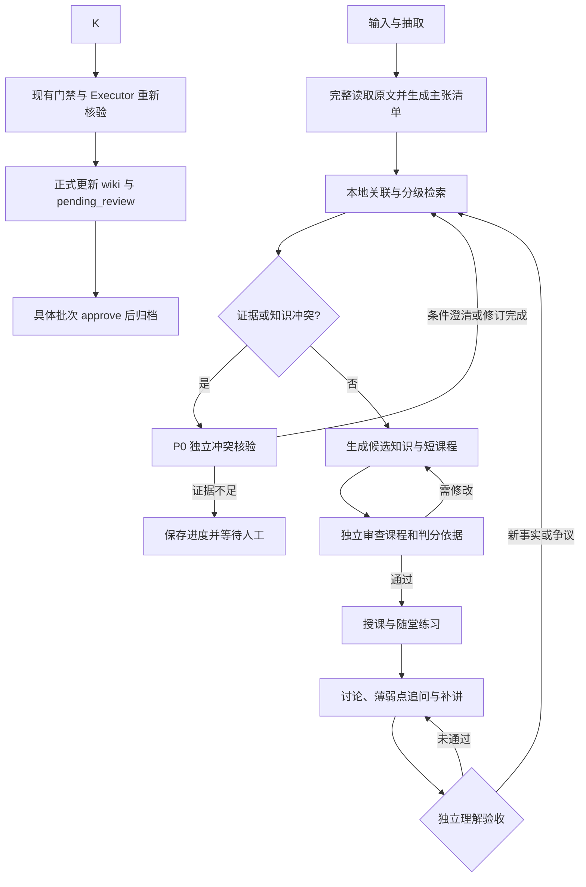
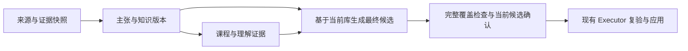

---

> 公开设计摘编：保留通用契约与方案；历史验收、用户反馈、运行记录及本地素材不随仓库发布。设计条目不代表部署或验收完成。

## 1. 目标与范围

把资料整理、个人学习和知识维护连成同一个闭环：系统先讲清新资料及其与既有知识的联系，再通过练习、讨论与迁移验证理解；双方发现的资料错误、知识冲突和问题歧义进入核验，最后才形成可追溯的正式知识。

必须同时满足三个条件：**知识有依据、用户确有理解、变更符合维护规则**。用户认同不替代证据，模型判分也不等于事实正确。

- 先出课，后练习，最后验收。首次接触新内容时，不用考试代替讲解。
- 未完成学习时保留可恢复的候选与进度，raw 仍为 unprocessed；正式 wiki 和内容索引不更新。
- 按可验证主张分级核验，不对每句话调用全部检索工具。
- 默认短课和聊天反馈，复用已读资料；需要图示或可复习页面时再用已有 HTML 组件。
- 面向任何 Agent。原生子代理默认继承宿主模型，角色和上下文分离；不要求独立模型 API。
- 第一版不引入外部数据库、复杂本体、向量库或数学化掌握度模型，也不恢复完整权限隔离开发。

本文中的阈值和预算均是**待试点调整的建议值**，不是已验证最优参数。


## 3. 完整链路与暂停恢复



学习可以跨会话进行。暂停不是失败，也不会重置检索、模型调用、候选修复和冲突核验的预算。问题、来源或候选变化时，按受影响的知识点重验；不要求用户重新学完整批资料。

长期学习任务与现有 Coordinator 的短时执行 run 分开：学习暂停不直接复用它的 awaiting_human 或延长原 deadline。跨 run 共享额度、等待用户与活动执行计时的区别见第 11 节；事务重新生成与理解证据复用的区别见第 12 节。

学习期间如发现正式库已有错误，先记录待修订项并停用相关教学答案。需要立即修正正式库时，另建范围明确的维护操作，经原有门禁执行；不能借课程候选偷偷提前写入。

### 3.1 学习知识版本与最终写入事务分离

学习期间维护可追溯的知识版本：主张、证据快照、目标、课程及候选预览各有版本绑定，不把长时间学习直接绑成一个持续存活的写入事务。准备应用时，依据当前正式库生成完整最终 diff，再执行覆盖检查、当前候选确认和原有 Executor 复验。这样可以减少无关页面变动造成的事务反复重建，同时保留有效的理解证据。




### 3.2 总体架构与数据所有权

采用“持久事件驱动的统一任务运行时＋可恢复业务步骤＋受控领域能力＋现有文件事务 Executor”的架构。各子系统是逻辑模块，不是独立服务；每类状态只有一个权威写入方。运行时只执行确定性策略，领域语义由证据、输出、学习与沉淀模块判断。

| 子系统 | 唯一职责与数据所有权 | 明确不负责 |
| --- | --- | --- |
| Task Runtime | Event、Task、Run、Step、Invocation、统一预算、执行所有权、等待／恢复、策略、授权和凭据状态登记 | 证据或教学语义裁决、直接修改 Wiki 文件 |
| Host | 用户交互、工具接入、身份与权限入口 | 另一套业务总控、独立任务状态或预算账本 |
| Knowledge Evidence | Source、持久原文、Evidence–Claim 关系、Claim、冲突、核验、依赖传播和 KnowledgePackage | 用户掌握状态、正式事务授权 |
| Knowledge Output | 将指定 KnowledgePackage 表达为 Lesson、Article、VideoScript 等产物及输出质量记录 | 修改知识主张、学习验收、正式入库或发布授权 |
| Learning & Assessment | Objective、Tutor、Rubric、Assessment、练习／补讲、理解证据与判分校准 | 通用内容输出、来源持久化、正式写入 |
| Knowledge Persistence | 将知识包映射为 Wiki 候选，检查语义覆盖、图谱关系并生成 Readiness 输入 | 复制 Executor 的 WAL 与恢复 |
| Run Execution Driver（重构现有 Coordinator） | 执行已领取的有界步骤，返回产物与后续请求；内部修复受 Runtime 限制 | 独立权威预算、长期任务状态或第二套恢复 |
| Executor（现有） | 文件事务最终复验、原子接受、WAL、写入、回滚与恢复 | 长期任务、教学或证据业务状态 |

课程是知识输出的一种类型，只有学习流程要求课程输出连接 Learning & Assessment。文章、视频等输出复用同一知识包版本，但不强制经过学习门禁；若输出引入新事实、改变结论或扩大适用范围，必须提交新的知识修订请求。公开发布仍需要独立的输出审查和具体授权。

最终应用由 Task Runtime 驱动：KnowledgePackage→Knowledge Persistence 生成候选与覆盖记录→必要审查和学习验收→Readiness→用户授权→Executor 原子接受并应用→Task Runtime 归并结果。Readiness 不产生授权，Executor 不重新裁决教学质量。Executor 一旦接受事务并形成完整 WAL，后续恢复由 Executor 独立负责。

### 3.3 KnowledgePackage 与核心身份

KnowledgePackage 是各业务模块共同使用的稳定、版本化产物，至少包含：主张及适用条件；支持、反驳和限定证据；原文定位、版本与可读范围；已解决和未解决冲突；与已有知识的关系；知识包版本及内容摘要。

课程、文章、视频和 Wiki 候选都引用明确的 `knowledge_package_id/version/digest`。输出过程不得静默改变知识包；内容变化产生新的知识修订与版本。

长期任务使用 `learning_task_id`，原始批次使用 `raw_batch_id`，每次短时执行使用 `run_id`，每次调用使用 `invocation_id`，每次正式操作沿用现有 `operation_id`。KnowledgePackage、Candidate、ReviewCredential、Readiness、Authorization 和 Executor Transaction 分别版本化，通过摘要和 ID 显式关联。

学习层不长期持有 Wiki 锁、写入事务或 WAL。学习记录可按知识依赖局部失效；最终事务仍按 CandidateView／Executor 的完整依赖和目录检查整体失效。两者解耦的是生命周期和恢复责任，不是去除版本、证据和授权关联。

### 3.4 工程目录与阶段边界

代码按长期子系统职责划分，任务和验收按阶段划分。不得为每个阶段复制一套状态、协议或运行时。能力以可信本地 registry 显式注册，领域目录可以直接提供实现，不强制迁入 plugins/；本轮只更新设计，不创建或迁移代码目录：

```text
tools/wiki_runtime/
├── runtime/              # Event / Task / Run / Step / Invocation / 调度 / 预算 / 授权
├── host/                 # 交互、工具、身份与权限入口
├── coordinator/          # 单一执行路径的 Driver，不另保留旧调度／预算循环
├── executor/             # 文件事务、WAL 与恢复，保留现有结构
├── candidate/            # 最终候选与依赖快照，保留现有结构
├── contracts/            # 公共契约，保留现有结构
├── evidence/             # 拟新增：Source / Evidence / Claim / KnowledgePackage
├── learning/             # Objective / Rubric / Assessment / Calibration
├── output/               # 拟新增：Lesson / Article / VideoScript 等输出适配器
├── persistence/          # 拟新增：Wiki 候选映射 / 覆盖 / 图谱关系 / Readiness 输入
└── review/               # 审查协议，保留现有结构
```

S0 定义实体、模块接口、状态所有权和贯穿场景；S1 实现统一运行时、单账本预算、授权、原子接受与文件恢复；S2 接通最小证据链、知识包和 Wiki 候选；S3 接通课程、学习反馈、独立验收及必需校准；S4 完成来源演进、扩展校准和其他输出；S5 用真实小批次验证正确性、用户负担和成本。

阶段任务书及合成夹具可以按阶段命名，例如 `learning-ingest-s0-plan.md`、`tools/tests/fixtures/learning_s0/`；共享协议、实体和存储不得按阶段复制。每个模块应能独立测试，但通过版本化接口协作。

### 3.5 持久循环、存储与扩展决策

具体契约、故障矩阵及阶段前置见持久循环与受控扩展设计（未随公开仓库附带）。采用持久事件→确定性状态迁移→待执行工作→有界 Step→结果归并的循环；事件去重、状态和后续工作由 SQLite 事务串联。Task 执行状态与学习领域阶段分开，Run 是有界活动执行，Invocation 是一次实际外部调用；会话接续只作优化，恢复依赖持久资料与版本绑定。

工作流、能力与宿主适配器显式注册，固定版本及必需门禁，不建设通用插件平台、热更新、DSL 或完整事件溯源。插件只提议变更；身份、预算、授权和正式写入约束统一执行。S1 仅用合成工作流证明机制，真实证据及教学仍在 S2／S3 验收。目标入口统一委托 Runtime；旧入口若保留仅作适配，不维护双运行模式。数据库事务不代替 Executor 完整 WAL，两者继续通过同一接受屏障协调。


## 4. 输入分类与工具路由

路由依据是“载体类型 + 知识类型 + 学习任务 + 时效要求”，不能只看扩展名。一份 PDF 可能是论文、教程或新闻，需要不同核验方式；同一任务也可以组合多种工具。

| 内容与任务 | 首选路径 | 升级或补充条件 |
| --- | --- | --- |
| 个人笔记、实践与反思 | 本地原文、已有来源页 | 存在对外部事实的断言时，再定向核验 |
| Agent 等概念、机制与方法 | 原始论文、作者说明、本地证据节点 | 定义不同、证据不足或核心结论有争议 |
| Hermes 等项目的设计和行为 | 官方架构文档、Release、固定 commit 源码 | 文档不清楚时借助 DeepWiki 定位，再回源码核对 |
| DeepSeek Harness 等快速迭代项目 | 官方仓库与版本文档 | 不以另一个时间点的设计说明直接解释当前行为 |
| 库、框架与具体 API | 对应版本的官方文档，可选 Context7 | 检查实际返回版本；版本缺失时不得默认为精确匹配 |
| AI 资讯、新发布与行业动态 | AIHOT、通用搜索 | 追溯原始公告和原文，区分事件时间、发布时间、发现时间 |
| 研究论文及实验结论 | 知网等文献平台、arXiv、期刊／出版方／作者页面、PDF | 落到具体论文和内容类型；检查版本、研究方法、实验范围与更正／撤回，平台收录不等于结论已获验证 |
| 用户认可的博主与专家文章 | 主题限定的优先来源名单、原文与引用 | 优先发现和解释；如含原始实验，可按其方法与材料评价，不永久归为二手或自动视为权威 |
| 社区讨论、维护者答复与问题复现 | 具体帖子、GitHub Issues／Discussions、原始复现材料 | 保留上下文和日期；识别是否已解决、适用版本和独立验证，热度或点赞不代替证据 |
| 扫描件、图片与复杂排版 | PDF 渲染与按需 OCR | 提取不完整或存在视觉证据缺口时暂停相关教学与验收 |

本地关联默认从索引、结构化关系和直接证据节点开始；逐步扩大，不默认遍历整个关联图。原始 ingest 单元仍须完整读取一次，不能用检索片段代替原文阅读。

### 4.1 可演进的来源注册与路由

工具、来源和路由分别注册，避免每加一个博主就改程序或重写规则：工具说明“怎么获取”，来源说明“去哪里找、擅长什么”，路由说明“什么任务先找谁”。上表只是一组初始样例，不是封闭白名单。

来源可以来自用户推荐、已核对文献的引用链、官方项目链接、社区中的原始报告，或研究过程中发现的相关专家。用户推荐可以提高特定主题的检索优先级；不是对该作者所有观点的事实认证。

来源注册首版必填：identity、可定位的规范地址、来源类型、主题／主张适用范围、获取方式与访问状态、版本／时间信息、发现依据、启用状态及其理由。关键字段不可核实时明确记 unknown，并据此限制用途。作者身份等影响具体证据判断的信息仍须按任务核对，不因精简注册表而免核验。

别名、语言、用户偏好、质量观察、成本、复核时间及细分禁止范围等字段按实际用途逐步填充；初期用简单可审计规则路由，暂不做自动质量评分或复杂排序优化。来源试用、独立提升与降级边界继续有效，不能把“评分后置”解释成“新来源自动可信”。注册表是数据，不是第二个规则入口。

来源状态采用 discovered（发现）→ trial（限量试用）→ active（限定主题启用）→ restricted／retired（受限或停用）。初始来源也需要注明已验证与未验证的能力，不因预置而自动完成评估。

- **允许自动演进**：在既定研究预算内发现候选；记录推荐理由；小样本检查相关性、作者身份、原始链接、可访问性和时间；调整已启用来源在其批准主题内的检索顺序；对不可用或已有核实错误的来源暂时降级。
- **需要独立复核后提升**：常规启用新来源、扩展到新主题、增加关键冲突证据的用途。用户显式推荐的可读来源可按既定策略优先试用，无须每读一篇都询问；提升依据须留下记录。
- **不自动演进**：修改业务规则、放松入库／理解验收标准、让来源或模型给自己认证；安装插件、付费、登录新账户或扩大原先未授权的数据发送范围。新服务接入仍单独处理。

排序使用“任务匹配、直接证据、版本／日期匹配、独立性、已复核的质量记录、获取成本”；来源知名度和用户偏好用于同等条件下的顺序。普通点赞、模型自评或单次答对不足以提高事实裁决权。

出现来源失效、内容被修订或撤回、反复可核实错误、作者身份变化、获取成本异常时，触发复核／降级。降级不删除已有原文和学习记录；沿证据绑定标记需要重验的主张。新版本路由先在固定样例上比较覆盖、准确引用、重复率、调用数与时间，再决定是否推广，保留上一版以便回退。

### 4.2 未知主题和新增来源的接入

当现有来源不足时，先进行有预算的探索检索，沿一手文献和引用关系发现候选，不因“暂不在名单”就永远不用。记录为什么认为它适合该主题、有哪些可直接核查的证据，先进入 trial；无法核验其背景时仍可保留为线索，但不能悄悄升为关键裁决依据。

输入类型和来源适配器需要统一输出原件、抽取、定位、时间／版本、获取结果和质量信息。新增博客、社区、期刊或数据库，只增加适配／注册与质量样例；后续主张校验、课程和验收链路保持不变。暂不支持的内容进入人工补充或暂停，不假装通用适配器已经覆盖。

### 4.3 补证提升与首版输入范围

学习期间外部材料先保存在私有候选区；使用临时证据不等于已经成为正式来源节点。进入正式候选的外部事实必须能映射到持久证据及本地 sources，并作为受摘要绑定的原文输入提供给最终 G3。优先复用有效的已有 raw／来源；不要求每个网页新建 raw，但 URL、模型摘要或私有缓存路径本身不能替代已读证据。

当前 G3 的 `input_refs` 是库根相对、严格 UTF-8、直接进入依赖快照并绑定内容哈希的原文路径，不是 Evidence ID、外部 URL 或私有任务记录。Evidence 通过 `source_id`、定位、来源版本和内容摘要指向持久原文；Evidence 元数据文件不能代替 G3 实际读取所引用的原文。最终输入清单必须同时保留原 raw 与支持、反驳或限定相关主张所需的持久原文，且在 manifest 冻结前已经可读。

S0 必须确定“临时快照→持久证据→来源页→G3 input_refs”的最小协议，包括保存时点、定位与可读范围、批次关系、失败保留项和确认范围。默认学习未通过且未确认时，不因补证改变正式 wiki、索引或 raw 状态。若所选路径需要登记新 raw／assets，只能用现有 capture/import，不能塞进 ingest；S0 须说明何时获得与副作用相符的确认、采集后如何重建候选及依赖、是否需重新确认最终候选。原学习确认不能自动授权变更后的候选。若无法同时满足这些边界，该路径暂停，不能以“补证”名义例外放行。

S2 依据该协议实现最小证据与持久来源映射，S3 消费同一证据进行学习，S4 扩展来源与输出，S5 联测真实最终审查与应用。补证素材不得因存入同一采集目录而误并入原 ingest 单元；分组、整组推进和 approve 归属须遵循 AGENTS 并在 S0 样例中明确。独立采集已经完成而 ingest 失败时，保留合法采集结果和失败记录，不删除原文，也不把原批次标成已整理。

首版能力分开验收，S0 定范围、S1 核对实际状态：

| 材料 | 获取／教学范围 | 自动应用范围 |
| --- | --- | --- |
| PDF／OCR／多模态来源 | 按实际可读范围研究或人工补充；提取成功不等于核验通过 | 保留现有暂停策略，扩展支持另做样例验收 |
| partial／仅摘要可读 | 只讨论可见内容；缺失部分不能支持核心结论或判分 | 不能冒充完整来源；不得改扩展名或删来源类型绕过 |


## 6. 工具、来源与信息的独立分级

### 6.1 工具信任等级 T

| 等级 | 入选依据 | 默认策略 |
| --- | --- | --- |
| T1 优先 | 官方维护、接口明确、结果可追溯，适合当前任务 | 能满足任务时优先 |
| T2 常规 | 社区认可、维护活跃、使用与失败边界可核对 | 补覆盖缺口，试点后进入常规列表 |
| T3 备用 | 新项目、样本少或尚缺稳定运行记录 | 限定范围试用，不直接承担关键裁决 |
| T4 待审 | 来源、维护状态、输出或数据去向不清楚 | 默认不自动启用 |

Star、安装量和维护活动仅用于选择顺序，不给返回事实背书。官方提供的搜索工具也可能搜到错误文章；小项目的一手源码也可能直接证明一个具体行为。记录 provider、维护状态、Star／安装量快照日期、来源保留能力、已测成功／失败样本和适用范围。没有实际运行数据时，工具运行可靠性标为 unknown，不伪造置信概率。

### 6.2 来源依据 S

- **S1 直接证据**：适用于该主张的一手文档、原始论文、对应版本源码、可复现实验。官方发布只能直接证明其发布陈述，不自动证明比较优势或普遍效果。
- **S2 独立佐证**：有方法与出处的独立测试、研究或分析。检查是否实质独立，转载不算独立佐证。
- **S3 发现线索**：资讯聚合、搜索摘要、二手解读、AI 生成的仓库问答；关键结论尽量回到 S1／S2。
- **S4 待确认**：无法定位来源或条件不明的材料。个人经验保留观察范围，不能直接推广为普遍结论。

来源分级是针对“它能证明什么”，不是给网站永久贴真伪标签。

S1／S2 描述证据角色，不是永远固定的高低顺序。针对“是否普遍有效”这类主张，方法充分、条件匹配的独立研究可以比厂商自己的宣传更有分量；针对某个版本的真实程序行为，匹配版本的源码和可复现实验可能比期刊中的概括更直接。

### 6.2.1 学术平台、期刊、博主与社区的权重

知网属于文献检索／聚合平台；Nature 是期刊／出版品牌。两者都需要落到**具体文献、内容类型与证据**评价，不能用“从这个网站找到”代替核验。研究论文、综述、新闻、社论、学位论文和预印本的用途不同；不能给整个平台一个永久最高置信度。

| 待判断问题 | 更直接的材料 | 仍需核对 |
| --- | --- | --- |
| 某机制是否有效、是否能推广 | 条件匹配的原始研究、独立复现及有方法的综述 | 方法、样本、评价口径、利益关系、研究时间与适用范围 |
| 某项目当前如何工作 | 对应版本文档、代码与测试，必要时维护者确认 | 版本、环境与复现条件；不能以身份代替可验证行为 |
| 作者提出什么思想 | 作者原文、演讲／访谈的完整上下文 | 是作者立场还是客观事实；概念定义是否发生变化 |
| 某故障或新变化是否发生 | 原始社区报告、复现材料、维护者处理及发布记录 | 是否同一版本、是否修复、多帖是否转引同一报告 |

同行评审是质量评估信息，不是绝对正确保证。Nature 自身说明同行评审的作用及其局限；有评审文件时可作为补充材料，不假定所有内容都经过相同审查。[R14]

论文类核心证据优先记录 DOI、出版物与文献类型、论文版本、是否有可核对的评审信息、数据／代码及更正／撤回状态。Crossmark 可以提供参与出版物的更新信息，但依赖出版方提交与服务覆盖；“未查到撤回信息”不能记成“已证明没有撤回”。无法获取全文时只据可读摘要描述其有限信息，不推断实验细节，不拿未读全文裁决关键冲突。[R15]

### 6.3 主张核验等级 I

| 等级 | 信息 | 默认处理 |
| --- | --- | --- |
| I0 记录类 | 标题、个人体会、明确归属的作者观点 | 提取和标明归属；其中可验证的事实仍单独拆出核验 |
| I1 普通知识 | 有直接依据、相对稳定的定义和背景 | 核对原文，优先复用有效证据 |
| I2 核心知识 | 课程目标、机制解释、关键关联、判分依据 | 检查完整证据链，不足时定向补查 |
| I3 重点核验 | 快速变化、数字、强结论、重大操作建议、知识冲突 | 查适用版本的一手证据，必要时补独立佐证 |

主张分别记录归属（原文陈述／用户观察／系统推断等）和 evidence_status（证据支持／推断待验／存在冲突／待确认），以及核验理由、适用条件和下次检查触发条件。“作者确实这样说”与“结论存在争议”可以同时成立；不以模型自报“95%”作为门禁。

若界面需要置信度标签，只展示“依据充分／有条件支持／依据不足／有争议”，附依据与日期；不将多个来源的标签简单求平均。


## 7. 触发条件与处理优先级

| 优先级 | 触发条件 | 必须动作 | 不允许的降级 |
| --- | --- | --- | --- |
| P0 冲突核验 | 新旧主张在同条件下互斥；可靠新证据可能推翻核心知识；证据被撤回影响核心结论 | 立即冻结相关主张的入库和相关题目判分，建立冲突记录，进入独立核验 | 以高 Star、模型票数或检索超时宣布胜负 |
| P1 强制核验 | I2／I3 缺少直接依据；关键版本不明；结论超出证据；关键来源过期或不可读 | 补依据或降低为明确待确认；证据合格前不作为确定答案 | 以“用户答对”代替知识核验 |
| P2 常规核验 | 新增稳定知识、正式课程内容或语义关联 | 原文核对、本地复用，按缺口补查 | 每句话重搜、每个工具都调用 |
| P3 机械检查 | 索引重排、格式和无语义变化的路径修复 | 结构与依赖检查；若发现语义变化则升级 | 机械操作无条件触发出课和考试 |

触发还包括：输入内容／主张摘要改变、被引用来源修订或撤回、依赖版本改变、用户提出有根据的反例、课程审查发现错误。单纯打开页面或重建索引不触发新课程。

同一主张出现多个触发时取最高优先级，记录触发理由。P0 是处理优先级和局部阻断，不是无限预算；普通疑似差异可先快速核对版本、定义和时间，澄清后留下记录并解除阻断。


## 8. 知识冲突核验链路

1. **固定双方材料**：记录主张 A／B、原文定位、来源、时间、版本、条件和受影响页面；不覆盖旧结论，不改 raw 正文。
2. **核对比较条件**：确认是否同一对象、术语定义、版本、时间、实验设置和统计口径。版本演进、作者定义不同、主观偏好不同，不直接判为同条件事实冲突。
3. **明确裁决所需证据**：项目行为优先对应版本源码／测试；发布状态优先官方记录；研究结论核对原始实验及独立验证。搜索排名、热度和模型能力都不能替代直接证据。
4. **定向补证**：围绕能区分双方的缺口检索，不收集无关链接；识别多个报道是否转引同一个来源。
5. **独立审查**：Conflict Reviewer 根据双方材料和补证判断，先不看候选作者的自我辩护。要求给出“哪份证据解决了哪一个争议、适用于什么条件”。
6. **分类处理**：condition_resolved（条件澄清）、superseded（旧知识失效）、coexisting（定义／观点并存）、unresolved（证据不足）。不能为完成流程强行选赢家。
7. **影响追踪**：先沿直接 supports／contradicts 追踪知识页、课程、问题和验收记录；确有传播再扩大范围，不无边界重验整个库。

教学影响还须沿“主张—目标—前置目标”依赖传播，不能仅靠 wiki 的直接证据边判断；依赖不清楚时标记待复核。此追踪不缩小现有 Executor 的事务依赖检查，见第 12 节。

unresolved 默认不允许受影响的确定性结论或单一答案题入库。其他知识点可以继续学习，但该 ingest 单元保持未整理。用户以后如希望保存“争议本身”，应另行明确批准按争议性知识组织：保留双方观点与证据，验收理解争议及限制，而不是要求选择某方正确；默认不自动启用这一例外。

用户对模型判分的反例也可以触发本链路。若发现是系统、题目或来源错误，修正相关判分并保留原因，不把它算作用户知识薄弱点。


## 9. 课程、练习、追问与验收

### 9.1 先给课程，再要求回答

每节以一个可观察能力为目标，包含：问题与背景、核心机制、一个完整例子、与已有知识的连接、适用限制及来源。遇到未学过的必要前置概念，先补一个小节，不直接考试。课程默认短文本，可复用现有 assets；复杂流程再提供图或交互页面。

对输入文档不逐句出题。先建立“关键主张—学习目标—课程小节—题目—证据”映射；合并重复主张，优先核心和高影响知识。I0 的个人观点讨论其依据和边界，不以赞同作者为正确答案。

### 9.2 学习与验收分离

- 随堂练习可以看资料、得到提示和完整讲解，结果记为有辅助表现。
- 验收前明确范围与必要标准，默认独立解释或迁移到一个新场景，不提前展示推荐答案。
- 不要求与模型措辞一致；允许多种有依据的答案，检查关键条件、推理和证据。
- 正确方向但缺少条件时记 partial；空泛回答追问具体原因或反例，不能“说得像”就通过。
- 每关键点默认最多两次额外追问，仍卡住就回到补讲或保存进度，不能无限盘问。
- 补讲或提示后，用不同场景再独立验证；不能把照着答案复述记为独立掌握。
- 不默认以总分 70% 或 80% 放行；核心目标不能被其他简单题得分抵消。试点确定“必过目标”和可选拓展目标。

建议每节先覆盖 3–5 个关键点，每轮只问一个高价值问题。薄弱点追问优先于继续铺更多题目；不超出已讲范围进行入库验收。拓展兴趣可以另建候选课题，不偷渡为本次必过项。

### 9.3 讨论中的扩展和纠错

讨论引入的新主张重新走信息分级和证据链，分别标明原文、外部来源、用户实践或推断。学习和题目设计可以扩展材料，但不能替作者改写 raw，也不能把用户暂时接受的解释变成来源事实。

课程、题目或候选语义变化后，只让受影响目标的旧验收失效。原文、证据、课程、题目及候选摘要必须有可核对的绑定，防止“学的是 A，最终写入 B”。

### 9.4 最终候选覆盖不变量

覆盖对象是最终 diff 的全部语义变更，包括新增结论、改写、删除造成的范围变化和跨页关系；不限于课程作者挑出的关键主张。每项均须有稳定标识、候选位置、主张与证据处置、教学处置及理由。机械变更可标记不适用主张，但必须有可复核依据。教学处置限定如下：

| 处置 | 放行要求 |
| --- | --- |
| 本次必过目标 | 已教，且有有效独立理解证据；核心机制与判分依据不得靠可选项绕过 |
| 复用既有目标 | 既有理解证据的范围、条件和版本仍适用，经复核后复用；不能只因旧页存在就视为已掌握 |
| 可选拓展 | 有适用证据和不属于核心目标的理由，经独立审查认可；不强制考试，不宣称已经掌握 |
| 非教学处置 | 明确归属的记录、获准保留的争议描述，或无语义变化的机械修改；分别核验归属／授权／差异，不免除证据与冲突规则 |

未映射、证据处置缺失、分类理由不足均阻断。生成者不能自行把难点、核心结论或判分依据降为可选／非教学；独立审查需对照完整 diff 检查遗漏与分类。争议记录仍受第 8 节约束，不因进入此表自动获得例外。缩小课程不能留下未处置的语义变更；如缩小候选，须保留整组 raw 规则及必要配套更新并重审。

脚本检查映射引用、覆盖记录和摘要绑定；语义审查判断主张划分是否完整、机械分类是否真实、证据是否适用。记录数量或模型自报“全覆盖”不能替代后者。要求全覆盖处置不等于逐句考试。

固定反例：候选从首次冻结就含 A、B，只讲并验收 A，B 从未进入映射；即使候选摘要不变，L3 也必须拒绝。S0 固定该例和可选项正例，S2 建 Wiki 候选完整映射，S3 绑定并核验必过／复用目标，S5 对真实最终 diff 重验。


## 10. 角色与调用策略

| 角色 | 职责 | 何时调用 |
| --- | --- | --- |
| Task Runtime／脚本 | 状态、路由、单账本预算、版本绑定、门禁和恢复协调 | 每个操作；尽量确定性实现 |
| Run Execution Driver（重构现有 Coordinator） | 已领取 Step 的候选生成、修复和检查 | 仅执行，不拥有独立权威预算或长期状态 |
| Researcher／Worker | 获取材料、提取主张、提出知识和课程候选 | 准备阶段；复用已有资料 |
| Tutor | 讲课、练习、回答疑问、针对误解补讲 | 用户学习时，复用当前教学上下文 |
| Reviewer／Assessor | 独立审查课程与判分依据；验收理解 | 对明确的候选／目标集合批量审查，不每句话都开代理 |
| Conflict Reviewer | 针对争议进行独立证据核验 | 仅 P0；不自动改规则或授予例外 |
| Rule Auditor | 审查运行规则／验证器争议 | 有实际失败与申诉依据时，复用现有有界协议 |

角色是职责边界，不等于每轮都启动七个 SubAgent。默认同一宿主模型，独立审查使用新的最小上下文，只带任务、规则、原文／证据、候选或作答；不携带生成者的自我辩护。普通授课不无条件开并行代理；冲突任务才追加核验角色。

知识冲突和规则申诉分别处理：前者核对内容证据，后者核对约束与实现。不能借规则审计给缺证据的知识放行。

认证责任与角色意见分开：Researcher/Worker 只写候选产物；Tutor 提供教学和辅助作答记录，不能签发自己的通过记录；Reviewer、Assessor、Conflict Reviewer 读取各自必需的规则与证据并返回绑定任务的意见，不能修改正式候选、预算或批准。Reviewer/Assessor 可复用实现，但课程审查与理解验收必须是分别绑定的独立任务上下文。Rule Auditor 只提规则建议，不能解除知识冲突。

Host 提供角色身份与交互证据；Task Runtime 核验任务／候选／证据绑定，统一认证、保存、失效、撤销及审计，不接受模型自填 passed。用户可撤销自己的应用／归档确认；证据或候选变化由 Task Runtime 使相应记录失效，旧记录保留原因。Executor 仍独立复验并应用，任何子 Agent 都不授予自己写库权限。

S0 要给出上述读写／认证责任的最小接口与真实宿主能力清单。在后续阶段首次依赖某项宿主认证能力前，用合成任务验证身份绑定、缺角色拒绝和跨任务重放拒绝；不支持时只能做明确标注的组件试验，不能通过依赖该能力的阶段门禁。完整真实闭环仍在 S5；测试替身、当前聊天能启动 SubAgent 均不代替该证据。不恢复完整 OS 隔离，也不要求为继承宿主模型另配 API。

### 10.1 模块、统一 Agent 调用与审查凭据

业务职责分为 Knowledge Evidence、Knowledge Output、Learning & Assessment 和 Knowledge Persistence；Task Runtime 统一推进流程、调用、预算、授权、等待、恢复和结果登记，Host 只承担交互、工具和身份接入。来源获取是 Knowledge Evidence 的输入适配层，Knowledge Output 只扩展表达适配器，Learning & Assessment 只承担学习专属能力。

Researcher、Tutor、Reviewer、Assessor、Conflict Reviewer 和 Rule Auditor 共享 Task Runtime 的 Invocation 组件，以角色配置、输入契约和独立任务上下文区分职责。共享模型和基础代码不代表共享身份、权限或统计独立性；每次调用绑定 task、run、invocation、role、输入与证据版本、规则版本和宿主认证记录。

独立审查针对冻结输入和产物形成 ReviewCredential，绑定内容、证据、规则、审查配置、角色和适用范围。只有由 Task Runtime 认证独立调用、完整记录不可变且最终接受时所有绑定仍有效，才允许复用相同语义范围的审查结果。摘要匹配本身不证明语义正确；可信身份或绑定能力未实现时，保留 Executor 重新调用独立 Reviewer，不得以 Coordinator 自带报告替代。


## 11. 调用成本、缓存与停止条件

| 调用等级 | 建议投入上限 | 升级条件 |
| --- | --- | --- |
| C0 本地复用 | 不新增外部请求；复用原文及有效证据 | 本地覆盖不足、来源变化或重要条件不明 |
| C1 单源核对 | 累计最多 1 轮检索、2 份新材料；已有 URL 可不搜索 | 关键缺口仍存在或出现矛盾 |
| C2 定向补充 | 累计最多 2 轮检索、4 份新材料；补充材料需检查实质独立性 | P0／高影响问题仍未解决 |
| C3 冲突研究 | 一个有范围的独立核验任务；累计最多 3 轮检索、4 份新材料（包含前两级消耗） | 仍无充分依据则暂停，扩大预算需用户决定 |

以上限制按一次长期 Learning Task 共享，C 等级是累计上限而非追加额度。S0 定义请求数、字节、模型调用、活动时间、修复与申诉预算及其计数单位；一轮可包含哪些请求必须明确，不能用合并工具批次藏匿调用。

Task Runtime 只维护一份权威 Invocation 记录和账本。每条记录包含任务、Run、operation、请求摘要、预留、发送状态、结果和结算。在同一次原子操作中检查任务总额度、Run 上限、并发额度及最终验证留额并完成预留，不再分别扣减两个权威账本。

相同 invocation_id 必须绑定相同 spec_digest 和任务／Run 作用域；重放读取原记录，不重复调用或扣费，新实际尝试使用新 ID。调用结果未知时保留 unknown 并保守计入，只有可证明未发送时才允许释放预留。崩溃恢复从同一记录判断预留、发送、结果和结算状态，不存在双层账本对账。

每个 Run 仍有有限 deadline，Learning Task 另计累计活动时间；等待用户不消耗活动时间，新 Run 不刷新总账本。补讲、重验和最终审查共用该账本，不足即暂停。unknown 只表示缺少 token 统计，不代表其他预算无限。

- 原文完整读一次并保存；外部证据按 URL、版本、内容摘要去重；同一文章的转载按共同源归组。
- 命中缓存不意味着事实永久有效；快速变化、明确版本变化或撤回事件触发重新核对。保留 provider 的缓存时间及 ETag；不可读时不能伪称已刷新。
- 对稳定历史原文可以继续教学其历史观点；无法核实的当前状态不能按“最新事实”讲解或判分。
- 限定每次带入模型的相关原文窗口和关联页面，避免反复输入整库和全部历史问答；原文覆盖记录仍保留。
- 同时限制工具请求数、页面数、输入字节、模型调用数、每 run 截止时间、累计活动时间、候选修复和申诉次数，重启不能退款。
- 无实际 token 统计时记录 unknown，不估算虚假的精确消耗。展示“为何调用、查到什么、为何停止”的简短记录即可。
- 预算不足、模型／工具不可用、引用缺失或来源冲突默认转暂停。缩减课程或候选是用户选择的新修订，必须有修复与复验额度并重新绑定授权，不能作为耗尽后的自动降级路径。

复习单独计预算。忘记某个知识点不撤销合格的知识页；发现知识本身错误才启动修订与影响追踪。

同时观测用户成本：实际学习时间、追问／补讲次数、重复确认、恢复学习需要的额外步骤。等待用户不计入模型活动时间，也不能把等待时长冒充学习时间。没有可靠记录时标 unknown。延迟复习是可选效果观察，不能变成长时间入库前置；观察指标与模型／工具预算分别记录。


## 12. 实体、状态与持久化

### 12.1 核心实体与最终写入方

| 实体 | 主要内容 | 权威写入方 |
| --- | --- | --- |
| Raw／Raw Batch | 原文、流程元数据、稳定批次身份及整组关系 | 现有采集与 Executor 流程 |
| Runtime Task／Event／Run／Step／Invocation | 执行状态、持久输入、业务进度、调用、统一预算、执行所有权、阻断和工作项 | Task Runtime；学习阶段由内置工作流受控提交 |
| Source／Evidence | 持久原文、定位、摘录、版本、内容摘要和提取状态 | Knowledge Evidence，经允许的持久化接口 |
| Evidence–Claim Relation | evidence_id、claim_id、supports／contradicts／qualifies、适用条件、关系核验状态 | Knowledge Evidence |
| Claim／Conflict／KnowledgePackage | 命题、归属、适用条件、证据关系、冲突、既有知识关系、知识包版本与摘要 | Knowledge Evidence |
| Objective／Rubric／Assessment | 目标类型、前置依赖、判分依据、作答证据和实际 evaluator 版本 | Learning & Assessment；Task Runtime 认证审查记录 |
| Lesson／Article／VideoScript／OutputArtifact | 知识包版本、输出类型、表达内容、证据映射和输出专属质量记录 | Knowledge Output；新增语义提交知识修订 |
| Candidate／Manifest／Snapshot | 最终变更、公共事务字段和完整依赖快照 | Run Execution Driver／CandidateView |
| ReviewCredential | 冻结输入、审查结论、角色、证据、规则、配置和适用范围 | Task Runtime 认证，独立 Reviewer 提供意见 |
| Coverage／Readiness | 最终 diff 处置、证据与学习凭据、版本绑定和未决阻断 | Knowledge Persistence 生成，Task Runtime 认证状态 |
| Authorization | 动作、范围、候选与 Readiness 摘要、状态和审计 | 用户发起，Task Runtime／ApprovalStore 分别持久化 |
| Executor Transaction／WAL | 正式事务、应用步骤、结果与恢复 | 现有 Executor |

Evidence 自身不保存单值 relation，因为同一证据可以支持一个 Claim、反驳另一个 Claim。关系记录必须绑定证据版本并保留历史；Claim 的当前证据状态由其关系、核验和冲突记录形成，不把关系结论误写成 Evidence 自身属性。

### 12.2 状态分维度保存

- Runtime Task：`ready／running／waiting／paused／blocked／completed／canceled`，不硬编码教学阶段。LearningState 单独保存 `preparing → lesson_ready → studying → assessing → understanding_verified → awaiting_confirmation → applying → applied` 及暂停来源。拒绝确认是审计事件，之后由用户选择继续学习、暂停或取消，不伪造通过。上述分离属于待完成的 S0 协议增量，不是现有解析器能力。
- Learning Objective：`unlearned／learning／demonstrated_once／reinforced／needs_review`，按目标分别记录，不用一个全局掌握状态代替。
- 知识生命周期：`candidate／current／superseded／withdrawn`；`stale`、`disputed` 和来源撤回是可与既往核验、应用记录并存的证据条件，不混入生命周期枚举。
- Readiness：`current／stale／superseded`，历史记录不可变。
- Authorization：`issued／revoked／consumed／expired`，与具体动作和候选绑定。
- 应用状态：`not_applied／applied／compensation_pending／compensated`；raw 的 `unprocessed／pending_review／processed` 仍由现有流程独立维护。
- Executor Transaction：沿用现有状态机，不复制到学习任务中。

### 12.3 私有持久化与依赖传播

使用 `.wiki-runtime/learning/runtime.db` 统一保存任务、事件、步骤、账本、租约、等待和受控领域状态，私有 `artifacts/<task-id>/` 按摘要保存候选预览等不可变产物；Run 与 Executor operation_id 只作为关联记录。SQLite 事务、备份、schema 升级、产物发布与接受屏障按运行时设计执行，不保留整份 JSON 权威账本。临时模型请求、完整问答、授权和恢复数据不自动发布进 wiki 或 Git。已应用知识依赖的持久原文和来源页不能随私有学习目录清理而消失。

证据或版本变化沿 `Evidence–Claim Relation → Claim → Objective 及前置 Objective → Lesson／Rubric → Assessment → Coverage／Readiness` 检查传播。学习记录只使受影响对象失效；影响不明时保守暂停。最终事务继续按完整依赖和目录检查整体重建，纯格式或无关页面变化也可能使旧事务失效，但不要求重新学习无关目标。

### 12.4 租约、fencing 与原子事务接受

同一 raw 批次默认只有一个活动 Learning Task。租约包含 `lease_owner`、单调递增的 `lease_generation` 和到期时间；领取、续租、释放均须原子完成，续租和释放必须同时匹配 task、owner 和 generation。

学习状态、证据结果、Assessment、候选及 Executor 操作创建采用条件提交：owner、generation 和有效期检查与业务写入位于同一持久事务或串行化临界区。Task Runtime 私有 pending 操作记录额外绑定 learning_task_id 和创建时 generation，不修改公共 v1 manifest。

Task Runtime 先读取并认证 pending 的完整性与身份，再调用 Executor 的短锁 `lookup_terminal`，在 Run deadline、baseline／provenance 新鲜度、授权预检或新审查之前返回身份一致的 applied／recovered 历史结果。只有非终态才继续预检。Executor apply 内仍保留初始及最终两次 journal／active 检查；随后在锁外完成自己的 G3，使撤销可以在审查期间真实完成。最终锁内再次检查 journal／active，重建 CandidateView、重跑 G0–G2 并复验完整依赖、目录、payload、规则与版本，只有锁外 G3 仍绑定相同字节才复用该意见。首个 WAL 前必须再次重验 Candidate、Readiness、授权撤销状态及 fencing。授权撤销、Readiness 失效和租约换代必须与该最终准入使用同一跨进程串行化边界，或由持久层条件接受保证旧状态不能写入，不能留下“检查完成后、WAL 创建前”的竞态。

首个完整 WAL 同时记录事务接受与完整写入意图，是唯一接受标志，不另建接受记录。没有完整 WAL 视为未接受；已有完整 WAL 视为已接受。接受前的撤销、失效或换代必须拦截；接受后由 Executor 独立完成或恢复，不因之后租约变化而中途撤销。

Executor 回滚后的 `recovered` 不能归并为学习任务的应用成功。回滚后保留仍有效的学习证据，应用状态保持未完成；重新应用使用新 operation 和新事务，并重新核验当前 Candidate、Readiness 与授权。

### 12.5 字段与校准绑定

Objective 至少声明 objective_type、required_evidence、rubric 和 pass_condition。概念、机制、程序性、迁移和综合推理目标必须使用相匹配的验收证据，不能相互替代。

评分规则分为可复用的 `rubric_template` 与本课内容判据 `rubric`：前者描述提示独立性、目标证据类型、关键条件缺失和判分输出等通用规则；后者描述本课正确答案、必要条件与证据定位。校准主要绑定 suite、rubric_template、evaluator 和适用 objective_type，避免每节课重建整套独立标签与 holdout；本课答案正确性仍须独立证据审查。

Assessment 同时绑定实际 rubric_template、rubric 和 evaluator 的版本。只有适用模板–evaluator 组合已通过校准，且本课 rubric 的证据审查有效，相关 Assessment 才能作为 L2 凭据。模板、evaluator、提示词或适用目标类型变化会触发受影响的重新校准；本课 rubric 变化至少使相关 Assessment 失效并重新进行内容审查，不无条件重建无关模板校准。

这些仍是待实现的数据契约提案，不是现有 schema。模型不能自填 passed，Task Runtime 的确定性复验只验证字段、引用、摘要、状态、预算和审查凭据，不代替知识、课程或理解的语义判断。


## 13. Readiness、授权与正式写入门禁

暂用 L 前缀区分拟新增教学检查，不占用或重定义现有 G0–G5：

- **L0 证据就绪**：最终语义差异全部登记主张及证据处置；拟作为确定事实入库的内容有可定位、适用的证据，P0／P1 阻断不得被标签绕过。
- **L1 课程就绪**：先讲后练；目标、前置条件、关联、例子与限制覆盖，独立课程审查通过。
- **L2 理解就绪**：必要目标具有与 objective_type 匹配的独立理解证据；提示辅助不冒充独立掌握，适用的判分校准门禁通过。
- **L3 应用就绪**：对最终 diff 重验完整覆盖，全部必过／复用目标凭据有效，证据、课程、候选、规则和依赖版本匹配，未决阻断为空，G3 原文输入可解析。L3 输出不可变 Readiness 及 `readiness_digest`，**不包含用户授权**。

### 13.1 单向授权协议


- `ingest_authorization` 是 Task Runtime 管理的新增业务授权，Host 只提供 owner 交互与身份入口。Task Runtime 在普通 ingest 的 Executor apply 前预检，Executor 还须按 §12.4 在 G3 后、首个 WAL 前最终重验；不能声称现有 ApprovalStore 已支持 ingest。
- `approve_authorization` 继续使用现有 ApprovalStore、ApprovalHandle、完整 Executor context 和 G4。统一审计字段不直接加入封闭的 v1 ApprovalStore context；Task Runtime 私有映射关联 `approval context_digest ↔ learning_task_id／raw_batch_id／ingest execution_result`。
- ApprovalStore 继续保存现有签发、撤销和过期状态；`consumed` 由对应 Executor 已应用结果派生，不要求改写原批准记录。
- 一条用户指令可以表达同一 raw 批次的组合处理意图，但不预先签发两个真实凭据。ingest 使用当前候选的 Runtime 业务授权；待实际应用报告及 approve operation、candidate、manifest、snapshot 生成后，owner 再对完整 approve context 独立确认。
- Readiness、G3、Runtime 业务授权和 G4 分别回答不同问题，任何一项都不能替代其他项。

### 13.2 撤销与补偿

执行前撤销只使对应授权和待执行操作失效。ingest 已应用后需要撤回时，创建具有新 operation_id、候选和独立授权的补偿性维护事务，保留原历史。approve 已归档后同样通过新的补偿事件处理，不删除旧批准或静默反向迁移 raw。

公共契约 v1 继续冻结。未来若 L 检查或 Readiness 需要进入公开契约，先写版本差异、旧任务兼容和迁移测试，再统一发布；不临时给现有报告塞字段放行。
