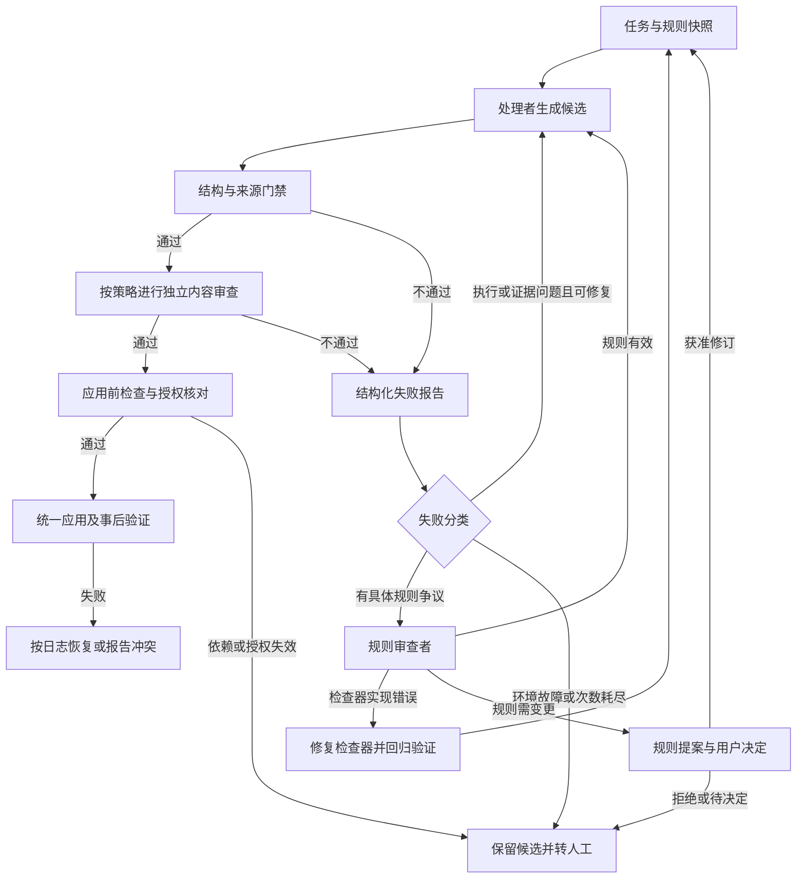

---

> 公开设计摘编：保留通用契约与方案；历史验收、用户反馈、运行记录及本地素材不随仓库发布。设计条目不代表部署或验收完成。

## 二、基本约束

1. **单一规则入口**：`AGENTS.md` 继续是规范正本。可执行规则清单只保存规则编号、正本位置、严重级别、验证器映射与版本，不另复制一套完整规范。
2. **原始正文受保护**：默认只允许白名单流程字段与经授权的移动，逐字节校验原始正文；普通 ingest、索引更新和 lint 修复不能改 raw 正文。
3. **候选与正式库分离**：处理者输出候选修改，验收者独立判断；正式写入由执行工具承担。
4. **先证明，再应用**：每份验收结果绑定具体候选摘要、依赖快照、规则与验证器版本。候选或依赖变化，相关通过结果失效。
5. **修改规则也要验收**：对规则的申诉只能产生提案，不能给当前任务提供绕过验证的权限。
6. **状态各司其职**：raw frontmatter 是素材业务状态真相源；操作记录是执行进度，不能制造第二套互相竞争的 raw 状态。
7. **有限循环**：失败不无限重试；不因超过预算、审查超时或模型坚持而自动降级为通过。
8. **证据与授权分开**：引用存在、审查通过、写入计划有效，都不等于用户同意 approve。


## 三、角色与权限

**默认由 SubAgent 继承主 Agent 使用的模型，不单独指定模型，不要求新增 API 密钥。** 本知识库面向任何 Agent；模型调用、登录与子代理创建由宿主提供，规则、候选契约、脚本门禁与执行器保持通用。独立 Responses API 入口只是可选适配，不作为使用知识库的前提。

继承的是模型选择，不是父会话的聊天历史、全部工具或写权限。宿主须为各角色建立独立上下文和最小能力集；不能用角色提示词或配置中的权限声明代替实际限制。不支持受限 SubAgent 的宿主仍可运行脚本检查，但需要独立审查时应暂停移交；没有权限验证时明确标为协作门禁。

先采用一个协调者、两个常规 SubAgent、一个按需 SubAgent。执行工具不算模型角色。

| 角色 | 职责与输出 | 可读取 | 可写入 |
|---|---|---|---|
| 协调者 Coordinator | 解析任务范围、分派、安排重试、报告进度 | 当前规则、相关页面、候选与验收报告 | 通过控制接口创建任务与调度记录；不能改正式库或规则 |
| 处理者 Worker | ingest、综合、改名等任务的候选页面、依赖清单和依据 | 任务、规则、必要 raw 与 wiki | 自己的候选区；不能给自己签发验收结果 |
| 内容审查者 Reviewer | 对照原文审查事实、证据、冲突与语义关联 | 原文、原页面、候选差异、固定规则版本 | 只向可信运行器返回审查结果；不改候选或正式内容 |
| 规则审查者 Rule Auditor | 区分规则缺陷、检查器错误、执行错误与证据不足 | 规则、失败轨迹、原文、反例、相关测试 | 返回规则审查报告与修订建议；不能直接生效 |
| 门禁与写入工具 Executor | 运行检查、核对授权与前提、应用和恢复 | 正式库、候选、可信运行记录 | 按白名单修改正式库与执行日志；不能自行决定知识结论 |
| 用户 | 决定范围、approve、重要规则修订与争议处置 | diff、证据与审查结论 | 通过可信入口确认具体变更；保留正常手动维护能力 |

处理者与审查者可以使用相同模型，但隔离任务上下文，分别调用。审查者先看原文、任务、候选和规则，不先接受处理者的自我解释；发现问题后再允许处理者举证回应。不同调用仍可能产生相关错误，不能宣称由此获得事实正确性保证。

开始时不再细分实体 Agent、索引 Agent 等角色。索引生成优先使用脚本；只有实际出现并行工作量或明确失败模式，才增加角色。是否换用不同模型以评测结果为依据，不在本方案中固定品牌或版本。


## 四、所有操作如何接入门禁

| 操作 | 候选或产物 | 必需验证 | 模型审查与人工条件 |
|---|---|---|---|
| capture / import | 原始附件、解析文本、定位映射、来源元数据组成的候选资料包 | 输入类型、完整性、原件保留、附件与定位映射、允许路径、重复与版本检查 | 抽取不确定或不完整时暂停；适配器只能申请登记 unprocessed，不能推进 pending_review/processed |
| ingest | 来源页、知识页、反向边、索引、overview、日志、raw 元数据 | 路径与字段、raw 正文不变、来源映射、入边、关系双通道、整组状态 | 内容审查；通过后最多推进 pending_review，归档仍需用户批准 |
| approve | 批次迁移清单、元数据、所有 raw 引用修复、索引与日志 | 用户批准绑定、目标冲突、正文不变、整组迁移、旧路径全文检索 | 不重复做整篇语义审查；若内容自上次审阅后改变，则重新确认对应变更 |
| 索引重建 | 标记区域、目录条目与说明 | 覆盖完整、链接可解析、不删手写分组、输入未变化 | 纯确定性生成无需模型审查；新增或改写语义说明时再审查 |
| query | 回答与所用证据清单 | 实际读到的页面、引用目标、权限及必要的时效说明 | 当前实现对所有有证据答复独立审查，避免回答器自标“事实”跳审；未来若有可信风险分级，再评估简单问答免审 |
| inspool | 回答沉淀出的候选知识页及配套修改 | 引用、关系、索引、证据来源，不能把模型回答自动升级为事实 | 内容审查；必要时先补来源证据节点 |
| health | 只读检查报告 | 验证器正常完成、报告绑定当前快照 | 无 LLM；保存报告和追加日志属于单独受控写入 |
| lint | 语义问题清单、可选修复计划 | 修复部分经过相应写入门禁 | 检查可以用模型；修复不能由同一角色自批自改 |
| 改名、移动、合并 | 文件清单、引用更新、索引与审计 | 递归路径解析、无覆盖、无引用遗漏、范围与内容守恒 | 合并语义需内容审查；尊重用户手动分类，不擅自重组 |
| 规则与工具维护 | 规则 diff 或验证器代码 diff | 授权、规则映射、回归用例、兼容与迁移检查 | 独立审查；修改 AGENTS.md 须用户批准，工具修订不能借机降低标准 |

只读操作仍经过任务范围与输出检查，但不需要创建假写入事务。任何日志、缓存或图谱落盘也要使用受控写入接口，不能以“只是日志”为由绕过。普通低风险内容变更沿用现有授权，不新增每步人工确认；approve、规则修订等按其明确授权条件执行。


## 五、门禁分层

| 门禁 | 核查内容 | 检验主体 |
|---|---|---|
| G0 范围与能力 | 操作类型、允许目录、输入是否完整、所需权限 | 确定性工具与可信入口 |
| G1 来源与不变量 | raw 正文哈希、允许字段、引用来源、依赖快照 | 确定性工具 |
| G2 结构与关系 | health、索引覆盖、来源回链、锚点、反向边与双通道关系 | 确定性工具；关联语义另审 |
| G3 内容与证据 | 摘要忠实、具体数字出处、事实/推论区分、冲突是否保留 | 独立内容审查者 |
| G4 应用前置条件 | 全部必需门禁、候选摘要、授权绑定、读取时哈希仍一致 | 统一执行工具 |
| G5 应用后检查 | 实际字节与候选一致、配套文件和业务状态完整、可恢复记录 | 统一执行工具 |

G2 中部分能力尚需开发，不能把现有 health 的零问题当成全量门禁已通过。语义门禁也不使用未经校准的“置信度超过某分”替代原文依据。

只验证候选文件本身不够。验证视图必须由**当前库快照叠加候选的新增、修改与移动**构成，检查受影响的来源、关系、索引和状态，不能误把旧正式库的通过结果用在新候选上。

已有问题采用基线对比：不允许新增违规，不允许扩大相关问题；修改范围及其依赖内的阻塞问题必须处理。无关的旧语义问题保留待办，避免每次小修改被迫重写全库。原文保护、有效授权和写入路径约束始终执行，不能用“历史遗留”豁免。


## 六、修复循环与规则申诉循环



### 内容修复

建议默认最多 **3 次候选提交，包括首次提交与 2 次修复**。每轮返回规则编号、证据、预期行为与失败类别。只有相关候选或依赖改变，才重跑失效门禁；不得修改失败报告来制造通过。

遇到证据不足，可收窄结论或明确标注待确认；不能编造来源。遇到输入缺失、模型调用失败、解析器崩溃等环境问题，进入单独的有界重试，不当作内容或规则失败。全任务另设总调用与时间预算，规则审查不能重置预算无限循环。

### 规则申诉

多次失败不自动说明规则错误。处理者必须提交：争议规则编号、失败证据、与任务目标的冲突、最小反例、建议及影响范围。有清晰的规则相互矛盾时，可以提前申诉，不必耗尽修复次数。

规则审查者给出四类结论：

- **规则有效**：指出候选实际违规点，返回剩余修复机会。
- **验证器实现有误**：规则不变，先补失败测试再修复检查器；旧通过凭据按检查器新版本重新验证。
- **规则需要变更**：提交 diff、反例测试、对既有页面的影响及迁移计划，等待必要批准。
- **证据不足以裁决**：停止自动循环，携带候选与争议报告转人工。

默认每个争议进行一次规则审查；没有新证据不重复唤醒。用户未回复不是批准。规则审查者、协调者或处理者都不能单方面放宽规则、关掉检查或授予自己豁免。


## 七、操作记录与验证结果

建议在独立运行目录保存执行状态，不将过程噪音堆进知识页。以下仅是未来布局示意，目录尚未创建：

```text
.wiki-runtime/
  operations/<operation-id>/
    manifest.json          # 任务类型、范围、读取依赖、原始哈希、候选摘要
    candidate/             # 候选文件
    reports/               # 结构检查、内容审查、申诉记录
    journal/               # 应用进度与恢复备份
    result.json            # 最终状态与实际修改清单
  rule-snapshots/           # AGENTS.md 与验证器映射的版本快照
```


最小记录包括：operation_id、操作类型、任务与输入引用、规则正本及映射摘要、验证器/审查提示版本、读取依赖哈希、每个目标的预期旧哈希、候选摘要、轮次、门禁结果、必要授权、实际应用文件和恢复状态。无旧目标时使用明确的“必须不存在”前提。

失败报告示意：

```json
{
  "operation_id": "示例操作",
  "candidate_digest": "候选摘要",
  "rules_digest": "规则快照摘要",
  "gate": "G3",
  "result": "fail",
  "findings": [{
    "rule_id": "EVIDENCE-001",
    "severity": "blocking",
    "category": "unsupported_claim",
    "target": "候选页与具体段落",
    "evidence": "原文只支持条件 A，候选将其推广为所有情况",
    "expected": "收窄结论或补充可核实证据",
    "repairable": true
  }]
}
```

operation_id 只负责追踪，不是授权秘密。用户批准由可信交互入口接收，绑定操作类型、目标批次、候选变更与有效前提；模型自行填写 human_confirmed=true 不能构成批准。候选变化或批准范围外的修改需要重新核对授权。

执行状态建议为：prepared、checking、repairing、rule_review、awaiting_human、ready_to_apply、applying、applied、failed、recovery_required、recovered。它们不写入 processing_status；素材仍使用原有 unprocessed/pending_review/processed。


## 八、写入、恢复与实际隔离

### 写入与恢复

统一执行器核对读取依赖及目标哈希，验证候选，记录恢复数据，逐步应用，并在成功后完成操作记录。多文件写入应称为**可恢复批次**，不承诺整个文件树原子切换。

写入顺序必须尊重业务流程：ingest 的来源页、知识页、关系、索引、overview 和日志就绪后，才推进 raw 至 pending_review；approve 才在用户批准的批次内执行迁移及引用回补。阶段中断时保留 journal，禁止另一个任务继续叠加写入未恢复状态。

恢复只能回滚本操作仍持有的字节版本；发现用户在其后修改文件时停止并报告冲突。重复 apply/recover 不重复创建页面、移动文件或追加日志。批次应包含必要的目录变更与目标冲突检查；Windows 原生路径、Unicode、junction/symlink、同步软件和外部编辑冲突都需验证。

### 两个隔离等级

- **协作门禁**：所有已接入命令自觉调用统一执行器。可先落地和观测，但只要 agent 仍有任意 shell/文件写权限，就不能宣称无法绕过。
- **强制门禁**：Worker、Reviewer、Rule Auditor 和协调者对正式库及规则只读；仅受控执行器拥有正式写权限，且模型不能修改执行器、授权记录或受信报告。通过受限工具、隔离工作进程或 Windows 账户/ACL 等实现，按选定运行环境验证。仅新建 SubAgent 或目录不足以实现这一等级。

可信边界必须覆盖脚本自身和规则快照；若同一模型能修改验证器后再运行，门禁仍可被绕过。用户正常手动维护继续被允许；执行器需要识别并保护这些外部修改。


## 九、规则治理与现有设计兼容

- 规则修改申请单独建操作，不与正在争议的内容候选一起偷渡应用。规则批准、验证器更新、旧页面迁移分别留下记录。
- 当前任务固定规则版本；批准修订后重新建立规则快照和验证结果，不能沿用旧版本通过凭据。
- 对外部内容和 agent 解释保留不信任边界，审查依据优先回到 raw 与本地来源页，不把讨论过程当成来源事实。
- 0001-state-storage（未随公开仓库附带） 中 processed_into 时机的分歧是首个适合走规则审查的案例；先明确主规则与现有实践，不为了让旧 ADR 看似一致而偷偷改状态。
- 0003-hermes-integration（未随公开仓库附带） 描述调度与交互入口；Hermes、其他 CLI 或桌面 agent 将来都应调用同一执行器。调度系统不能自带另一套批准或写入规则。
- 本方案不新增知识分类层、不重组用户子目录、不替代现有 raw/source/knowledge 证据结构。


## 十二、输入扩展与适配器契约（待实现）

### 当前支持边界

本节基于本轮仓库代码核对，区分“有操作约定”和“已有自动化实现”：

- **Markdown**：当前 raw 扫描、队列生成和 health 的流程检查均以 `.md` 为主要单位。
- **微信链接**：已有 `tools/wechat_article.py`，可抓取、解析并输出 Markdown，`--raw` 会直接写入 unprocessed。目前未接入本文拟建的统一执行器；本轮未实测在线抓取，不保证任意文章当前可访问或提取完整。
- **PDF**：ingest 模板识别 PDF/图片等多模态素材，并设置暂停条件；仓库没有统一 PDF 解析适配器。把 PDF 放进目录，不等于现有队列和检查器已完整管理它。外部 agent 临时读取 PDF 也不等于建立了可复用管线。

因此，当前架构可以扩展，但原方案尚缺输入接口；以下是明确补入的设计目标，不代表已支持任意格式自动导入。

### 两段式输入流程


采集获取内容，解析负责提取，ingest 负责知识判断。适配器不能自行总结并把摘要当原文，也不能写知识页、改规则、标记处理完成。注册适配器只是增加可信实现及能力声明，不能由一篇输入文章指定要运行的解析代码。

### 标准资料包 v1

所有适配器交付同一份版本化契约；具体格式只影响采集、抽取与质量评估：

| 字段组 | 内容 | 用途 |
|---|---|---|
| 契约与身份 | package_version、source_id、source_revision、原始输入类型 | 统一入口、兼容检查、跨解析器追踪；类型不能因转成 MD 而丢失 |
| 来源 | 原文件或 URL、可确定的标题/作者/日期、获取时间 | 保留出处；无法提取的字段留空并说明，不编造 |
| 原始载荷 | 原文件或网页快照引用、字节哈希、获取状态 | 保留可回查原件；PDF 不用转写稿替代原文件 |
| 抽取内容 | 非总结性的 Markdown/文本、附件清单、文本与附件哈希 | 为现有 ingest 提供可读输入；图片和复杂表格可以保留独立资源 |
| 定位映射 | 内容块对应的 PDF 页码/区域、网页小节或媒体时间段 | 审查时回到真正来源，避免只在摘要之间循环引用 |
| 解析过程 | adapter_id、适配器/解析器版本、配置摘要、是否使用 OCR/模型 | 区分来源变更与重新解析；使提取结果可追踪 |
| 质量报告 | complete/partial/failed、错误、缺失项、抽取统计与证据 | 决定可继续、重试、换解析器还是人工核对 |

这些是建议接口字段，不要求一次在每篇 raw frontmatter 中写满。完整过程信息可保存为受控来源清单，raw 仅保留必要引用与现有业务元数据。解析状态与 processing_status 分开；partial 不是 pending_review 的同义词。

资料包可使用持久 source_id 识别同一来源，修订身份结合原始载荷或可用快照确定；URL 本身不作为唯一内容版本。原件哈希、抽取文本哈希和解析器版本分别记录：同一 PDF 换解析器不伪装为新出版来源，同一 URL 返回新内容也不静默覆盖旧证据。

### 兼容当前 raw 结构

建议继续以一个 Markdown 来源记录作为队列入口，原始 PDF、HTML 快照、图片与定位附件保存在 `raw/assets/` 的来源资源组中，由来源记录指向它们。采集质量通过后，执行器创建该记录并登记 unprocessed；失败暂存运行区，不制造空正文 raw 来掩盖失败。

这使现有以 MD 为单位的队列可以复用。本文不要求现在迁移旧资料或重排目录。已捕获的原件与抽取正文保持不变；重解析形成新候选与显式版本关系，不覆盖原始证据。资源组的生命周期由来源清单关联，不能简单把附件目录的每个文件算成一篇独立 ingest 素材。

### 格式专属的前置门禁

| 输入 | 专属检查 | 失败处理 |
|---|---|---|
| MD / 粘贴文本 | 编码、非空、元数据与附件链接 | 返回缺失项，保留用户原始字节或输入记录 |
| PDF | 文件可读、加密/损坏、总页数与覆盖、阅读顺序、OCR 使用、关键表图缺失 | 有界重试或换解析器；仍不完整则人工核对，不让模型凭空补页 |
| 微信 / 普通网页 | 实际文章正文、标题、抓取状态、截断迹象、图片可用性、登录/验证页识别 | 不把验证页当正文；保存失败原因，必要时请用户提供可访问副本 |
| 音频 / 视频（未来） | 转写覆盖、时间段映射、说话人不确定性、关键画面是否遗漏 | 保留转写不确定区间；不能把音频转写视为已读取全部画面 |
| 外部服务 / 聊天记录（未来） | 访问范围、分页完整性、消息身份与时间、附件、编辑版本 | 使用授权范围内的连接器，未读页与缺失附件显式标记 |

通用门禁关注资料包结构、引用和完整性声明；格式门禁检查各自的失败模式。未知格式或未知契约主版本返回 unsupported，不能一律按纯文本继续。不能证明完整时，应诚实标记 partial；需要人工决定的部分不因转换格式而消失。

当前 ingest 的 PDF/多模态暂停约定继续有效。原始输入类型和 OCR 标记必须传递到后续策略，不能把 PDF 转为 `.md` 后就当作普通 MD 绕过暂停；是否允许特定纯文本 PDF 自动继续，需在规则治理流程中单独决定。

### 新输入方式的接入流程与验收

新增格式时，只要语义可通过资料包 v1 表达，目标是**新增适配器、格式质量检查和测试夹具，不修改知识生成、修复循环、规则申诉和写入核心**。适配器至少提供类型识别、能力声明、提取、资料包校验；契约新增必需字段或无法表达的新语义则走版本升级，不能承诺任何扩展都零改动。

验收包括：完整与损坏样本、部分提取、重复导入、同 URL 内容变化、解析器升级、附件缺失、异常中断和既有格式回归。注册后先按保守策略试运行，未通过质量门禁不进入知识生成。

把微信现有脚本接入时，优先复用抓取与解析函数；将 `--raw/--out` 等落盘路径收束到受控 capture 操作。PDF 则先实现可追溯的文字提取与原件保存，再按需要增加 OCR/表图处理。两者都无需为每种格式新增独立 SubAgent；处理者按能力调用工具，只有解析不确定时才按需增加专门审查。
