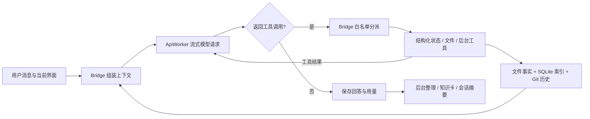

# Lattice Agent Harness 源码审查

> 本文为上游 Harness 审查记录。审查证据（探针结果、原始材料、证据索引）未随本仓库发布；引用上游源码时绑定[上游来源清单](../upstream-sources.md)的固定提交与文件路径。文中结论为源码与离线探针口径，不含上游测试套件、完整运行时、模型 API 与原生沙箱的验证。

日期：2026-11-16。范围：评估 Lattice 作为学习应用底座的 Agent 执行支撑能力；本轮不设计课程迁移，不改产品、不改用户 Learning、不调用真实模型。

## 结论

**Lattice 已具备完整的交互式教学 Agent harness，值得进入底座选型；其优势在共享学习状态、界面上下文和教学角色协作。执行可靠性、长任务恢复和强权限边界仍有明显缺口。**

它能支撑人在场、可以随时纠偏的持续教学，但不能因为有 Git、工具白名单和重试，就认为可以可靠地无人值守生产整套课程或强制保护正式知识库。本次没有证明真实 MiniMax 教学质量、长时间桌面稳定性或 Windows 沙箱能力。

## 审查对象与证据强度

- 本地只读源码：`references/upstream/lattice`，commit `762b00cb028ad1a86ee505db4ca5ed14103657ac`，版本字符串 `0.3.3`。
- 本次查询上游 main：`d8e6481f4620fe005d700fbfa6a20509be1ab0ff`，比本地多 1 个提交，仅变更 README；本次所审 harness 源码与查询时 main 一致。
- 官方 `v0.3.3` tag 指向 `b5c127a8169da1a8a2062b33fa99be5bb7d26678`，本地源码比 tag 多 27 个提交。相同版本字符串不表示完全相同源码。已安装的便携发行不等同于本地 checkout。
- API 比对：[本地与 main](https://github.com/vimalinx/lattice/compare/762b00cb028ad1a86ee505db4ca5ed14103657ac...d8e6481f4620fe005d700fbfa6a20509be1ab0ff)、[发行 tag 与本地](https://github.com/vimalinx/lattice/compare/b5c127a8169da1a8a2062b33fa99be5bb7d26678...762b00cb028ad1a86ee505db4ca5ed14103657ac)。后一比较中 `providers.py`、`model.py`、`sandbox.py`、`bridge/turns.py`、`bridge/background.py` 未变，`tools.py`、`bridge/core.py`、运行器及 UI 有变化。因此本报告以固定源码为准，不声称逐字节审计了安装包。
- 已实际运行 离线探针（证据未公开，无法由本仓库独立复核：docs/design/evidence/lattice-harness-review-20261116/probe_harness.py），结果（证据未公开，无法由本仓库独立复核：docs/design/evidence/lattice-harness-review-20261116/probe-results.json）包含 **15 项观察断言**和核心文件摘要。断言通过包含“成功复现缺陷”，不等于产品质量全绿。
- 探针使用真实 `model`／`vault`／`providers`／`sandbox` 业务代码；Qt 的线程与信号外壳用替身，网络用 `httpx.MockTransport`。部分 Bridge／工具方法原样从 AST 提取执行。不是真实 GUI、Qt 调度或供应商端到端测试。
- 全部写入位于新建的审查临时库；没有访问实际密钥、修改上游源码或实际学习库。未运行上游全量测试套件。

## Harness 实际如何工作



主路径是 `bridge/turns.py` → `providers.ApiWorker` → `tools.call` → `model/Vault`，而非一个只有系统提示词的聊天窗口。耗时工作由后台线程执行，结果回 GUI 线程；模型本轮工具结果留在请求消息中继续推理。

## 已实现且有价值的能力

| 维度 | 源码事实 | 判断与限制 |
|---|---|---|
| 模型执行闭环 | 流式文本与推理、工具参数分片拼接、工具结果回送、错误分类与重试、长度截断续写 | 完整的实用闭环；真实函数探针验证普通与流式工具往返 |
| 上下文组织 | 每轮规则、学习者记忆、角色政策、技能目录；主题路线、档案节选、主会话之间的摘要；快答和小题反馈回流 | 与教学场景高度匹配；默认是消息窗口，不是 token 预算管理 |
| 界面与 Agent 共享状态 | `screen/tabs/tab` 读取当前位置、未保存草稿等；`open/ui/suggest` 作用到同一工作台 | Agent 能围绕学习者正在做的事教学，避免另一套影子状态 |
| 角色分工 | tutor、flash、coach、organizer、builder；每角色可配模型、历史长度、工具集和规则 | 已有实用分工，不是通用动态 DAG 调度或相互隔离的审查系统 |
| 记忆与学习状态 | `me.md`、主题档案、路线、会话摘要、JSONL 轨迹、薄弱点、知识卡 | 支持跨会话接续；模型评语与学习者自评有语义区分 |
| 学习者所有权 | 结构化 API 保留卡片阶段、复习安排、“我的理解”；shell 后检查部分越权改动 | 正常 API 和未提交误改测试通过；存在后述旁路 |
| 持久化与撤销 | Markdown/JSONL/ipynb 为事实，SQLite 为索引，Git 保存内容版本 | 实际验证删除临时索引后课程可重建；内容可恢复不等于运行可恢复 |
| 可扩展政策 | `agents/*.md` 覆盖角色政策；技能渐进加载；用户点选技能可注入全文；修改建议可审阅 | 调整教学方法有清晰入口；检查点大多依赖模型遵守文本规则 |
| 内容原语 | `lesson_save()` 保存 title/objective/state/body；`save_knowledge` 接入；`tutorial-production` 技能逐章生产 | Lattice 并非没有课程，它已有轻量课程对象与教程生产方式；不是正式课程验收状态机 |

主要源码：[Agent 定义](https://github.com/vimalinx/lattice/blob/762b00cb028ad1a86ee505db4ca5ed14103657ac/lattice/agents.py)、[请求与上下文](https://github.com/vimalinx/lattice/blob/762b00cb028ad1a86ee505db4ca5ed14103657ac/lattice/bridge/turns.py)、[模型循环](https://github.com/vimalinx/lattice/blob/762b00cb028ad1a86ee505db4ca5ed14103657ac/lattice/providers.py)、[工具层](https://github.com/vimalinx/lattice/blob/762b00cb028ad1a86ee505db4ca5ed14103657ac/lattice/tools.py)、[状态模型](https://github.com/vimalinx/lattice/blob/762b00cb028ad1a86ee505db4ca5ed14103657ac/lattice/model.py)、[课程生产技能](https://github.com/vimalinx/lattice/blob/762b00cb028ad1a86ee505db4ca5ed14103657ac/lattice/skills/tutorial-production/SKILL.md)。这里读取上游技能是研究对象，不是调用该技能。

## 按影响排列的发现

### H1 / P1：shell 后置保护可被 Git 提交绕过；技能目录漏保

`model.py:1317` 的 `police()`只检查未提交变更，并取当前 HEAD 作为恢复基线。`tools.py:441` 允许 shell，`bridge/running.py:84` 没有对 shell 内 Git 提交做隔离。shell 先改学习者字段，再自行提交，事后已经没有变更可供检查。

**实际复现**：临时卡片 `stage=seen` 被外部文件写入改成 `applied`，随即在同一个临时 Git 库提交；`police()` 返回空列表，字段保持 `applied`。对照测试中，只改不提交会被正确恢复。这说明保护有效但信任基线可由执行方移动。

另外，`tools._guard()` 禁止直接改 `skills/`，要求提案批准；`police()` 的保护目录却未包含 `skills/`。实际未经批准改写临时 `SKILL.md` 后，检查未恢复。该缺口不需要 Git 提交即可触发。

**影响**：不能用这些机制保证 Agent 永远不能改规则、技能或学习者专属状态；同一个执行主体可绕过自己的后置检查。Linux bubblewrap 即使隔离了库外目录，也不自动解决学习库内 `.git` 的信任问题。

**修复方向**：固定操作前基线且由执行端之外保存；执行权限不能写版本控制元数据和受保护文件；补齐技能保护。仅补一条提示词不能关闭旁路。本轮不实施。

### H2 / P2：批量保存半途失败仍留下内容，重试生成重复课文

`tools.py:629` 的 `save_knowledge()` 逐项写入课程、卡片、笔记和关系，直到最后才 `ctx.act()`；没有整批预验证、原子提交或幂等请求身份。

**实际复现**：批次第一节课合法、第二节标题为空。两次调用均报“标题不能为空”，第一节却各保存了一次，最终留下两份课程，完成动作记录为 0。模型看到的是错误，未得到第一节已写入的结构化结果。

**影响**：课程生成／整理时，“工具失败”不等于“没写进去”；照原参数重试会重复，用户也不能仅凭本轮成功动作列表判断实际修改。

**修复方向**：写前整体校验；为一批操作提供暂存提交或明确的部分结果；重试绑定稳定操作 ID。

### H3 / P2：取消模型回答不等于取消已启动的后台工具

`bridge/turns.py:452` 的取消只对 `ApiWorker` 调 `stop()`。shell 走 `tools.shell` → `Bridge.background` → `Sandbox.shell`，该后台线程与子进程没有按 run 绑定到取消链。shell 自己有超时，但这不是用户按停止时的取消。

**验证方式**：原样提取的 `rpc_cancel()` 停止了替身模型 worker，已开始的后台任务仍完成写入。结合 `core.py:170`、`running.py:84`、`sandbox.py:167` 的调用链判断适用于后台 shell；未执行真实 GUI 点停止与进程终止测试。

**影响**：停止回答后，正在下载、运行或写文件的动作可能继续；回调与已经完成的对话状态之间也缺少统一生命周期管理。

**修复方向**：按 run 跟踪工具句柄、传递取消信号，标明仍在执行／无法撤回的动作，并保留完成结果。

### H4 / P2：长对话可以先裁历史、后补摘要，且没有总输入预算

`bridge/turns.py:335` 按消息条数截历史，默认 tutor `history=24`，以半窗口步进保留约 24～35 条。`_earlier()` 只有已存在摘要时才补摘要。存档通常在离开会话或空闲 15 分钟后触发（`background.py:51/71`）；没有“摘要覆盖已被移出消息”这一前置检查。

**实际复现**：100 条消息、无摘要时，默认窗口只保留第 73～100 条，早期 72 条不进入当前请求，摘要为空。文件记录仍在，Agent 可以主动用 `conversation` 找回；本问题是默认上下文缺失，不是数据删除。

另有单附件、读取长度等局部限制，但没有按模型 context window 统一计算规则、历史、附件和本轮工具结果总量；多轮工具返回会继续累积。

**影响**：连续学习时容易漏掉早期目标、约束与约定；大资料与长工具链可能超上下文，单纯增加 history 不能同时解决成本和容量。

**修复方向**：裁剪前持久化并核对摘要覆盖；重要任务状态独立存储；给请求与工具结果设置统一 token 预算。

### H5 / P2：用量统计有失败盲区，循环限制不是任务预算

`providers.py:661` 仅在 `self.asked` 和 `self.partial` 同时存在时估算中断请求。已发出但没有返回正文（或仅返回推理／部分工具参数）的失败可能没有用量记录。

**实际复现**：MockTransport 收到一次 POST 后抛 ReadError，最终 `usage=null`。为聚焦计量路径，该探针关闭自动重试；没有声称供应商一定对失败请求收费。

`providers.py:861` 的 40 限制实际是工具**轮数**；单轮含 41 个调用会全部处理，探针已验证。40 轮限制本身有效，但不是调用总数上限，也没有整任务费用上限或跨重试硬时限。统计在 finished 后写 JSONL，进程中断可能丢失该轮累计信息。

**修复方向**：请求发出前登记尝试，区分实报／估算／未知；限制累计调用数、总输入输出和总时长，而不只限制单次 max_tokens。

### H6 / 架构限制：内容持久化较好，运行状态不是可恢复事务

`core.py:79` 的后台 jobs、job_running，以及 `turns.py` 的 active_runs、tools.Turn 和 ApiWorker 的工具消息均主要在内存。内容、对话、动作和部分运行记录会落盘；未找到通用的“工具开始／完成／结果未知”持久化协议、进程重启恢复正在执行的工具轮，或已完成副作用去重机制。

本项是源码架构判断，未做断电／杀进程测试。不能据此说所有学习内容会丢，也不能把 `checkpoint` 会话摘要当作执行 checkpoint。

**影响**：它的“接着学”与“长任务从精确执行点恢复”是不同能力。课程与笔记可以继续读，自动长任务仍需要人工查看实际产物再恢复。

## Windows 运行边界

`sandbox.py:155` 在 Windows 直接以用户权限启动进程，继承宿主环境；探针验证 `isolated=False` 且虚构环境标志会传入。工具说明也明确承认 Windows 没有沙箱，这是平台设计限制，不是隐藏功能。

因此工具级只读目录、权限白名单不能限制 shell 的全部文件访问，学习库之外的改动也不在其 Git 撤销范围内。评估框架时必须按真实 Windows 运行条件判断，不能套用 Linux bubblewrap 的保证。本轮没有读取或导出真实凭据。

## 对“harness 能力如何”的回答

- **教学交互与状态感知：较强。** 有明确的数据模型、工具和反馈通道，构成可以持续发展的学习应用底座。
- **模型与工具基本执行：具备且可用。** 流式、工具往返、角色工具集和重试都有真实实现。
- **扩展教学政策：入口清晰。** Agent 规则、技能、主题和课程原语足以承载较复杂教学方法；提示词检查点本身不提供执行保证。
- **长任务可靠性：偏弱。** 取消、半途写入、摘要覆盖、用量和恢复存在具体缺口。
- **强权限隔离：当前 Windows 版不具备。** 文件撤销与所有权检查应视为日常防误改能力。

当前审查支持“把它列为有实质基础的候选”，不支持“现状已经可无条件接管正式知识与长期自动课程生产”。是否最终采用，还需明确自己能接受的运行边界；不需要因为这些发现就把整个产品重做。

## 复现

在本知识库根目录运行：

```powershell
& '<本机学习运行时解释器>' -X utf8 -B 'docs/design/evidence/lattice-harness-review-20261116/probe_harness.py'
```

探针依赖已有 Python 环境中的 httpx、PyYAML 和系统 Git，使用 Qt 外壳替身；每次新建 `.tmp/lattice-harness-review/probe-*` 临时库。不要把该程序改为指向真实 Learning。